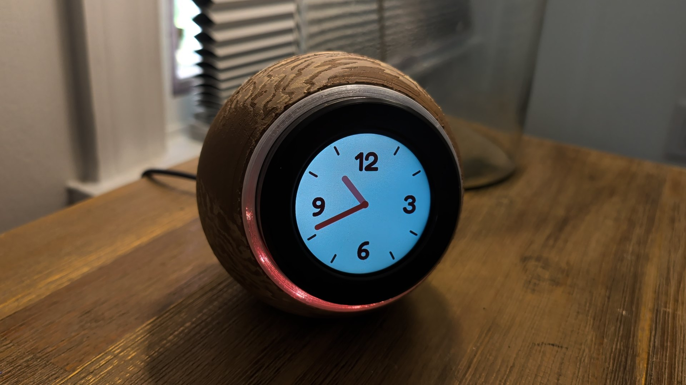
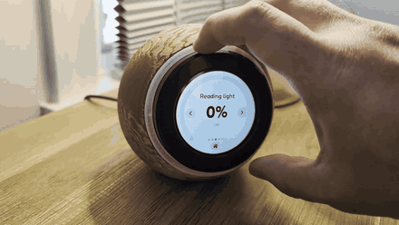
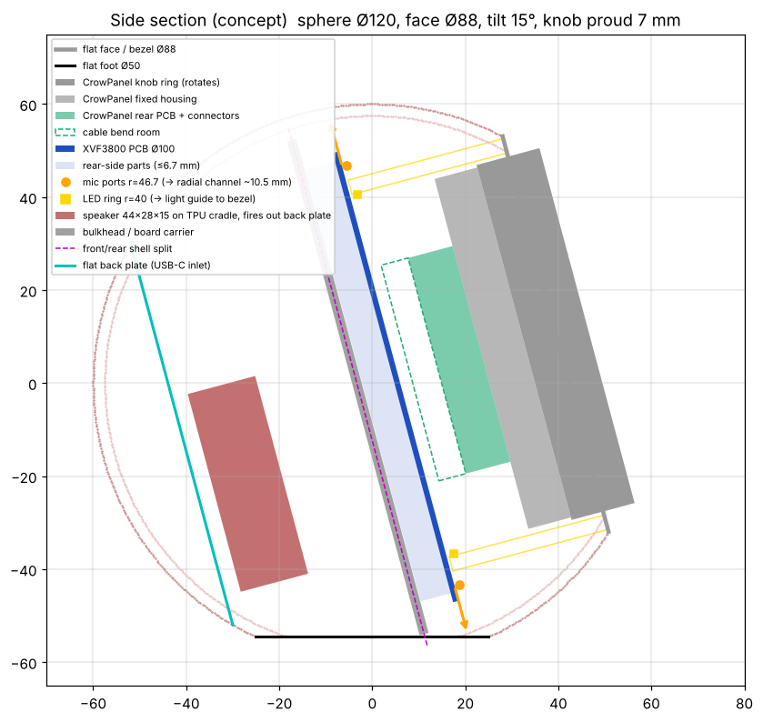
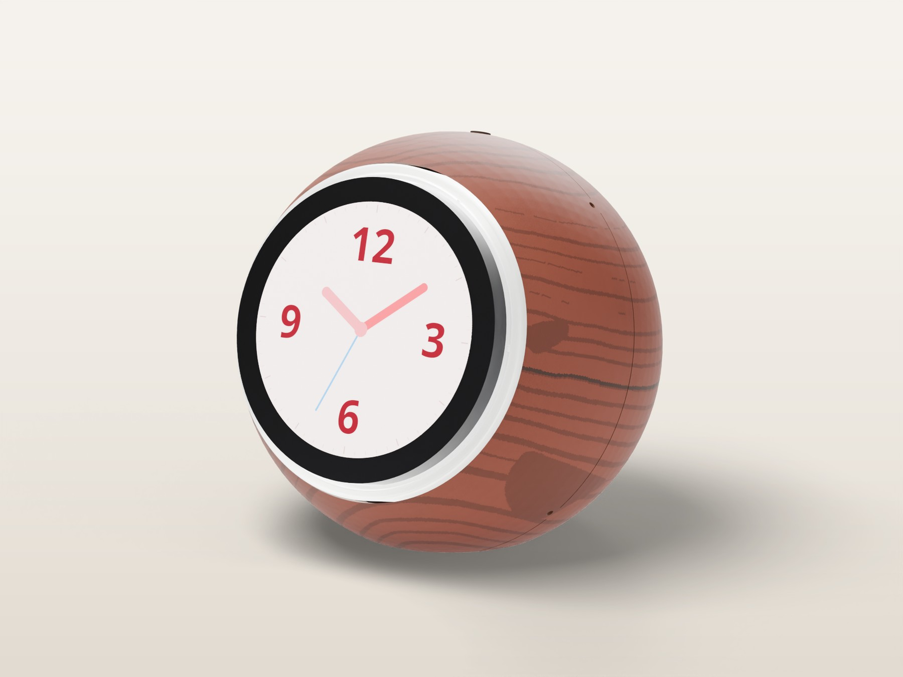
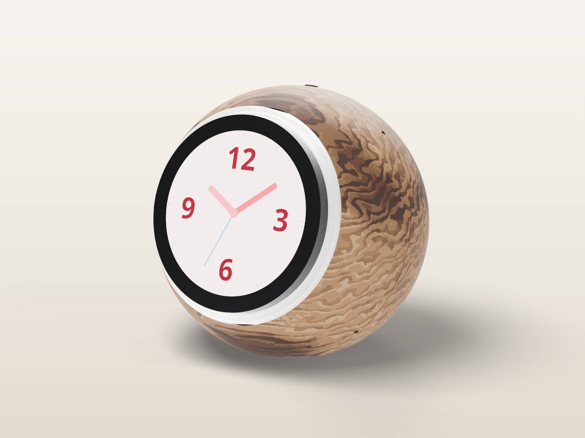

# Voice Clock

An open-source bedside clock and Home Assistant voice satellite: a knit-textured 116 mm sphere with a round knob display on the front.

[Full demo video (MP4, 34 s)](docs/img/real/demo.mp4)

- **Clock face and controls:** Elecrow CrowPanel 2.1" rotary display (ESP32-S3, 480 × 480 round IPS, turn-and-press knob, touch). Analog clock, timer ring, alarm, night mode and a light/media control page, in ESPHome + LVGL.
- **Light sensor (v3, untested variant):** an optional Adafruit right-angle VEML7700 looks out of a small window on top of the case and switches night mode when the room goes dark.
- **Voice:** Seeed reSpeaker XVF3800 4-mic array with XIAO ESP32-S3: wake word, echo cancellation, 3 W speaker and the 12-LED ring that lights a white-walled light channel round the knob.
- **Enclosure:** parametric build123d CAD, every dimension a named parameter, with automated interference and fit checks. Prints without supports. Both shells twist-lock, and a ballast pocket plus TPU grip pads keep it still when you turn the knob.

## Build it

| | |
|---|---|
| **Print** | [`print/`](print): `VoiceClock_U1.3mf` (4 plates, Snapmaker U1, per-part settings embedded), a ready-to-print U1 TPU plate ([`print/tpu`](print/tpu/README.md)), Bambu Lab projects for the X1C, P1S, A1 and A1 mini ([`print/bambu`](print/bambu/README.md)), single-plate 3MFs, and STL/STEP for any slicer. Filament slots: 1 = natural or clear PETG (the light ring's glowing band), 2 = matte PLA (shells, carrier and spider) or, on the light-ring plate, white PETG (the channel walls and mute button), 4 = TPU (grip pads and speaker washers). |
| **Wire** | [Wiring and soldering sheets](docs/wiring/WIRING.md) ([printable PDF](docs/wiring/wiring_sheets.pdf)): wiring diagram, exact solder points on each board, cut list, splice details, cable route and a power-up checklist. |
| **Assemble** | [Illustrated assembly guide](docs/assembly/ASSEMBLY.md) ([web version](docs/assembly/index.html)): 12 steps, numbered callouts for every part and fastener. |
| **Flash** | [`firmware/`](firmware): ESPHome config for the CrowPanel clock face. The reSpeaker runs the [formatBCE XVF3800 ESPHome integration](https://github.com/formatBCE/Respeaker-XVF3800-ESPHome-integration). |
| **Variant** | [`print/v3_light_sensor`](print/v3_light_sensor/README.md): **untested.** A rear shell and carrier for an optional ambient light sensor. Designed and checked in CAD only, not printed or wired yet. |
| **See it** | [All renders](docs/renders.md): both wood variants from four angles, and every assembly step. |
| **Modify** | [`cad/`](cad): `voice_clock.py` (model), `check.py` (fit checks), `make_3mf.py` (print files), `blender/` (photoreal renders and callouts). |

### Parts

| | Part |
|---|---|
| 1 | Elecrow CrowPanel 2.1" HMI ESP32 rotary display |
| 1 | Seeed reSpeaker XVF3800 4-mic array with XIAO ESP32-S3 |
| 1 | 4428 3 W 8 Ω speaker with JST-PH lead (its STEP model is in `cad/vendor/`) |
| 1 | USB-C breakout with 5.1 kΩ CC resistors, and a 5 V 3 A USB-C charger |
| 10 | Screws: 3 × M3 × 12, 3 × M2 × 20, 4 × M2 × 10 (socket head) |
| 7 | Brass M2 heat-set inserts (3 × 3.2 mm) |
| *optional* | *Light-sensor variant (untested): Adafruit #5378 right-angle VEML7700 lux sensor (about $5), a 100–150 mm STEMMA QT / Qwiic cable, 2 × M2 × 6 socket head and 2 more M2 inserts* |
| about 160 g | Steel BBs or shot in slow-cure epoxy (or about 300 g tungsten putty) for the ballast pocket |
| | 1/16" adhesive closed-cell foam, CA glue, 22 AWG wire, 2-pin JST-SM or JST-XH pair, MX1.25 4-pin pigtail, heat shrink |

The [build plan](docs/build-plan.md) explains the design decisions: mic-channel acoustics, speaker isolation, power, why the boards are clamped the way they are, and the known risks.

## Variants

| | |
|---|---|
|  | **Turned cherry** ([`print/wood`](print/wood/README.md)): the same enclosure printed in JAYO wood PLA on the Snapmaker U1, v2: only the outer skin is wood PLA (the core is plain PLA, so nothing load-bearing is brittle). The growth rings follow the grain in 3D, with the latewood on a second, hotter cherry head and walnut ring cores, at fixed temperatures and with no surface relief, so the bed faces print flat. Snapmaker Orca project, presets and the scripts that generate them. |
|  | **Turned walnut, Full Spectrum** ([`print/wood_walnut`](print/wood_walnut/README.md)): modelled on a real turned bowl. Snapmaker Orca's Full Spectrum layer mixing turns 4 heads into 8 tones: fine side-grain streaks that fade in tone, rippled end grain, lighter earlywood and soft heartwood zones, in JAYO oak, maple and walnut over a plain-PLA core (no cherry). About 1 day 9 h at 0.08 mm layers; print the tone swatch first. |

## Status

**Untested variant: v3 light sensor (13 Nov 2026).** This is an optional add-on to v2, designed and checked in CAD only. It hasn't been printed, wired or run on the hardware, so the default print files stay v2. Files and notes are in [`print/v3_light_sensor`](print/v3_light_sensor/README.md); build it from source with `VC_LIGHT_SENSOR=1`.

- **Where it sits.** Adafruit's right-angle VEML7700 board (#5378) lies flat on a pad at the top of the rear shell, behind the carrier, with the sensor against a Ø2.4 mm window just behind the mute button. The window looks up and 15° back, away from the display and the light ring, so the clock doesn't read its own glow. A small shroud round the window closes the gap between the sensor and the curved wall.
- **How it's wired.** A STEMMA QT lead runs to the XIAO's I2C pins on the back of the reSpeaker (through a new notch in the carrier's rim). The CrowPanel's own I2C port sits inside the light ring, where no lead can reach it without breaking the ring's glow.
- **What it does.** The reSpeaker publishes **Ambient Light** to Home Assistant (`firmware/respeaker-light-sensor.yaml`). The clock switches night mode on below **Night Light Level** (3 lx by default) and back above twice that. Without a reading, it falls back to the v2 rule (sun down and all bedroom lamps off).
- **Changed parts:** rear shell (pad, 2 inserts, window, shroud) and carrier (lead notch). Everything else is the v2 part.
- **Firmware without the sensor:** `voice-clock.yaml` falls back to the v2 night-mode rule whenever there's no light reading, so it behaves as before on a clock without one.

Version 2 (6 Nov 2026), after the v1 print fell apart:

- **Twist-lock shells.** The front shell turns 10° clockwise onto 7 bayonet lugs on the rear shell and clicks into place on 4 flexure detent fingers, with hard stops. The back plate turns 32° on 3 lugs (one wide, so it only fits one way) and clicks on 2 flexure pawls; a coin slot opens it. v1's snap hooks let both pop off.
- **Keyed stack.** The cradle ribs run down the shell wall into notches in the carrier, so the electronics stack can't turn.
- **Light ring that works.** A hollow channel with white PETG walls (ring base + ring shell; no foil to fit) carries the LED light to a diffuser cap standing 2.35 mm proud of the sphere. The cap overlaps the inner wall, so you see an even glow, not the LEDs. v1's solid printed guide passed an estimated 0.4 % of the light.
- **Front shell prints face-up.** The sphere runs right up to the light ring, with no flat face, and no textured face sits on the bed.
- **Inserts everywhere a screw goes.** The USB-C breakout screws into 2 horizontal heat-set inserts, from the plate's rim side where a short hex key reaches; the speaker bosses have room below the screw tips.
- **Weight.** A 30 cm³ ballast pocket in the rear shell (about 160 g of steel shot in epoxy, or 300 g of tungsten putty) and TPU grip pads on the base: about 479 g in all, with the centre of mass 12 mm lower than v1.

`cad/check.py` checks every part against Seeed's reSpeaker STEP (put it in `cad/vendor/`), sweeps both twist locks with the detent fingers and pawls bent, and drops the stack in. v2 has not been printed yet; the tolerances to confirm on the first print are all single parameters in `cad/voice_clock.py` (`BLK_TOP`, `FING_BUMP_R`, `BP_TOOTH_RO`, `CARRIER_KEY_CLR`, `RING_BORE_R`).

The CrowPanel's native top points left (`lvgl: rotation: 90`, see `firmware/README.md`). The spider turns the panel 2.8° clockwise (`CP_ROT_TRIM_DEG`) to level the dial; check it by eye after assembly.

## License

MIT, see [LICENSE](LICENSE). Product names belong to their owners; this project is not affiliated with Elecrow, Seeed Studio or Home Assistant.
