# Voice Clock assembly

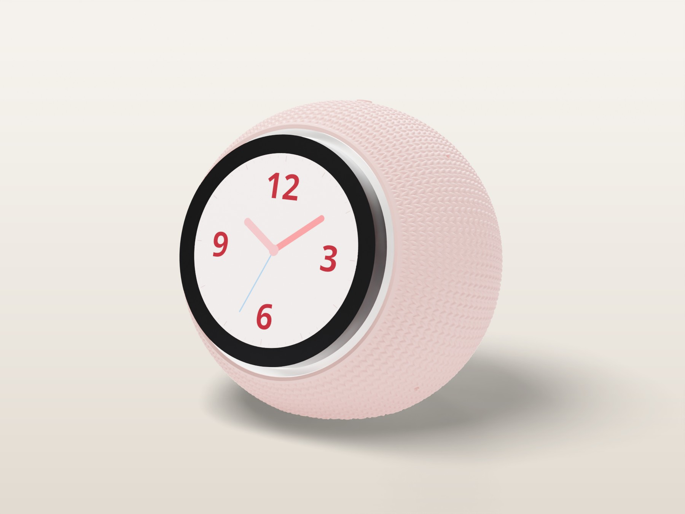

## Before you start

| Plate | Parts | Material | Notes |
|---|---|---|---|
| 1 | Front shell, rear shell, back plate, mute button | Matte PLA | 5 mm brim on the shells, no supports. Front shell face-down, rear shell on its back rim. |
| 2 | Carrier, spider bracket, 3 spacers, light guide, mute button, insert test block | PETG (clear or natural for the light guide) | Spider, spacers and light guide at 100% infill. Print the insert test block first. |
| 3 | 4 speaker washers (optional) | TPU | Or use M2 rubber washers. |

**Electronics:** Elecrow CrowPanel 2.1" rotary display (ESP32-S3); Seeed reSpeaker XVF3800 4-mic array with XIAO ESP32-S3; 4428 3 W 8 Ω speaker with JST-PH lead; 5 V 3 A USB-C charger

**Tools:** Soldering iron with an M2 heat-set tip and a 2 mm chisel tip; Hex keys 1.5 and 2.5 mm; Multimeter; Wire strippers, flush cutters, heat gun or lighter; Tweezers, craft knife, 5 mm and 2 mm hole punch (or scissors)

| Qty | Part | Where it goes |
|---|---|---|
| 3 | M3 × 12 socket head | Spider to the CrowPanel hub (replaces its 3 rear screws) |
| 3 | M2 × 20 socket head | Carrier through the reSpeaker into the spider |
| 4 | M2 × 10 socket head | Speaker (2), USB-C breakout into its backing wall (2) |
| 5 | M2 heat-set insert (3 × 3.2 mm) | Spider 3, back plate 2 |
| 1 | USB-C breakout with 5.1 kΩ CC resistors | Power inlet on the back plate |
| — | 1/16" adhesive closed-cell foam | 4 mic gaskets, 1 speaker ring |
| — | 22 and 24 AWG silicone wire, 2-pin JST-SM or JST-XH pair, MX1.25 4-pin pigtail, heat shrink, zip tie | Power harness (see docs/wiring/WIRING.md) |

## 1. Heat-set inserts

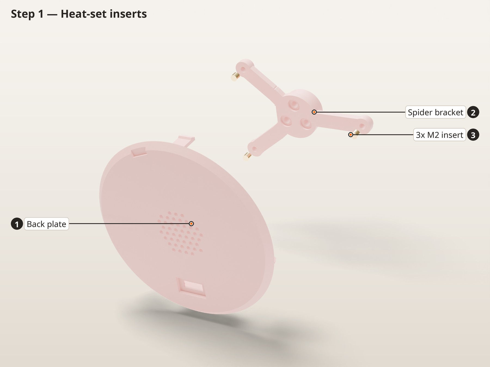

In this picture: **1** Back plate, **2** Spider bracket, **3** 3x M2 insert

1. Print the insert test block from plate 2 first. Set one insert in each hole and note which hole (1, 2 or 3 dots) holds best. The middle one is the default; if another fits better, change `M2_INSERT_D` in `cad/voice_clock.py` and reprint.
2. Set the iron to 230–240 °C for PETG (190–200 °C for PLA). Press each insert straight in until it is flush, then hold a flat tool on it for a few seconds while it cools.
3. Spider: 3 × M2 in the underside at the end of each arm. Back plate: 2 × M2 in the speaker bosses.
4. That's all of them. The shells and back plate snap together, so they have no inserts.

> **Check:** Run a screw into each insert by hand. It should start straight and stop on the thread, not on a blob of plastic.

## 2. Power harness

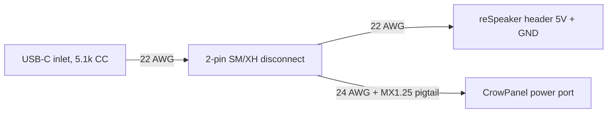

1. Follow the wiring sheets in `docs/wiring/WIRING.md` (printable PDF there too). Do their bench checks first.
2. Solder 10 cm of 22 AWG red and black from the USB-C breakout's VBUS and GND pads to the socket half of a 2-pin JST-SM or JST-XH pair. This lead stays with the back plate.
3. From the pin half, make a Y splice: one 22 AWG pair to the reSpeaker's 2×10 header (5V row 1 right, GND row 2 left, on the back), and one 24 AWG pair spliced to a spare MX1.25 4-pin pigtail for the CrowPanel's power port. Find the port's 5 V and GND positions with a meter on the supplied USB cable first.
4. Cover every joint with heat shrink and strain-relieve the solder joints so a tug never loads a pad.
5. Plug the speaker lead into the reSpeaker's speaker socket. It runs through the carrier's centre hole later.

> **Check:** With a multimeter, confirm 5 V and GND are not shorted. Power both boards on the bench and confirm they boot before anything goes into the case. Never plug a laptop into either board while the USB-C inlet is powered.

## 3. Spider bracket onto the CrowPanel

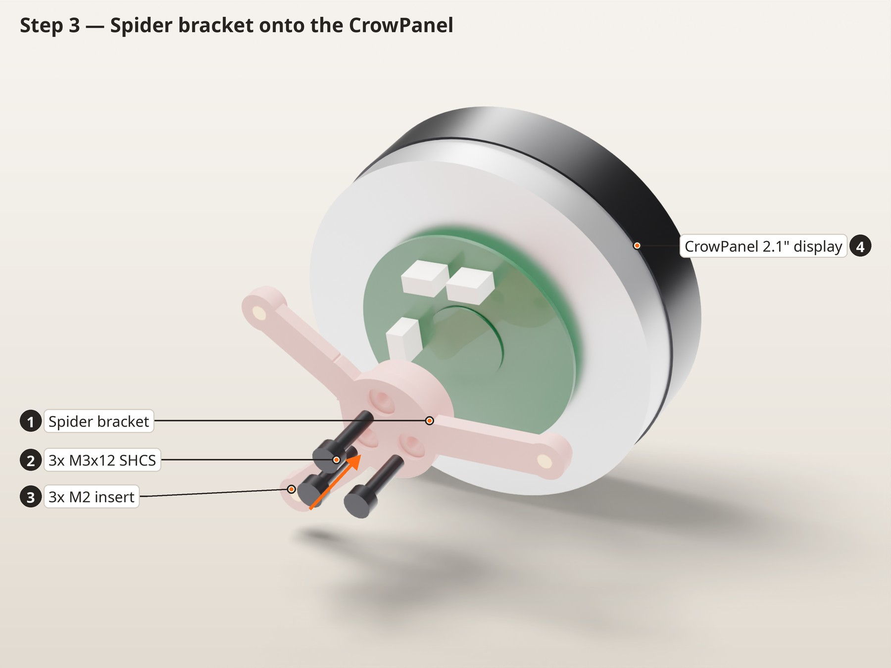

In this picture: **1** Spider bracket, **2** 3x M3x12 SHCS, **3** 3x M2 insert, **4** CrowPanel 2.1" display

1. Remove the three M3 screws from the hub on the back of the CrowPanel.
2. Fit the spider so its hub sits on the CrowPanel hub. Turn it so its arms run between the three 4-pin connectors; only one of the three screw positions leaves all the connectors uncovered.
3. Fit 3 × M3 × 12 from the spider side into the hub. Tighten evenly until snug.

> **Check:** The knob still turns and still clicks when pressed, and nothing touches the connectors.

## 4. Light guide from behind

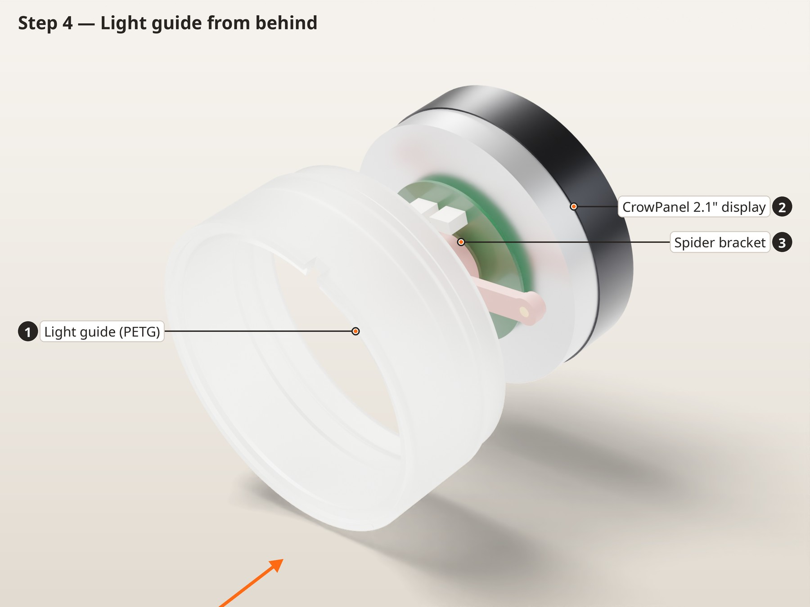

In this picture: **1** Light guide (PETG), **2** CrowPanel 2.1" display, **3** Spider bracket

1. Slide the light guide over the spider from behind and onto the display. Its inner land is smaller than the knob, so it only goes on this way. The land rides on the display's fixed housing (behind the knob ring) and keeps the guide centred on the knob.
2. Turn it so its cable notch sits over the CrowPanel power wires, at about 10 o'clock seen from the front (between two LEDs).
3. Punch four foam rings (5 mm across with a 2 mm hole) and stick one over each microphone hole on the front of the reSpeaker, on its four diagonals.

> **Check:** The light guide slides on with a light touch and the knob turns without touching it. The gap around the knob is about 0.45 mm and even all round.

## 5. Spacers and reSpeaker

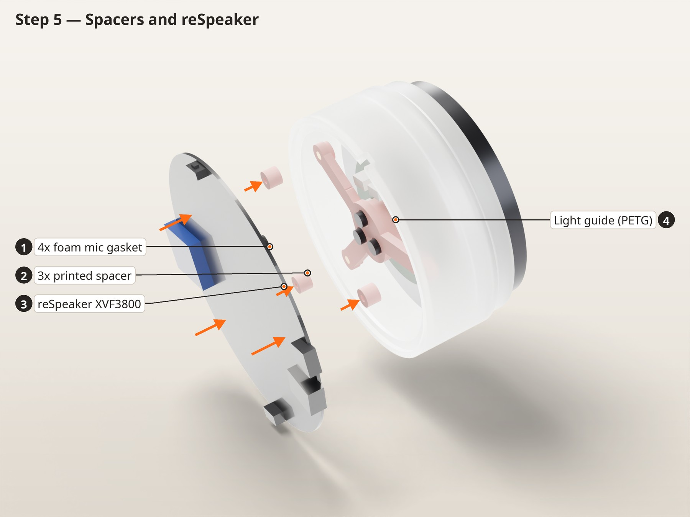

In this picture: **1** 4x foam mic gasket, **2** 3x printed spacer, **3** reSpeaker XVF3800, **4** Light guide (PETG)

1. Set the three printed spacers on the spider's M2 inserts.
2. Lay the reSpeaker on the spacers with its LED ring and foam gaskets facing the display. The mute button (marked A) goes at 12 o'clock and the RST button at 6 o'clock; the XIAO module then sits at 3 o'clock seen from the front.
3. Keep the CrowPanel wires in the light guide's notch.

> **Check:** All three reSpeaker mounting holes line up with the spacers, and no wire is trapped under the light guide.

## 6. Carrier and clamp screws

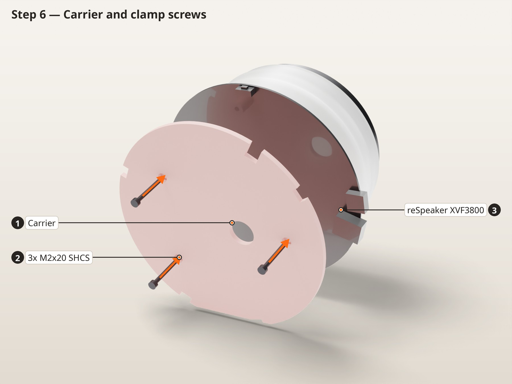

In this picture: **1** Carrier, **2** 3x M2x20 SHCS, **3** reSpeaker XVF3800

1. Feed the speaker lead and the reSpeaker power lead through the carrier's centre hole.
2. Set the carrier behind the reSpeaker with its cable notch lined up with the light guide's notch (10 o'clock seen from the front, 2 o'clock seen from the back).
3. Fit 3 × M2 × 20 from the back of the carrier, through the board and spacers, into the spider inserts. Tighten in turn until snug.

> **Check:** The board doesn't rock and no wire is pinched. This is the whole electronics stack; nothing else gets screwed in.

## 7. Mute button, then the stack into the rear shell

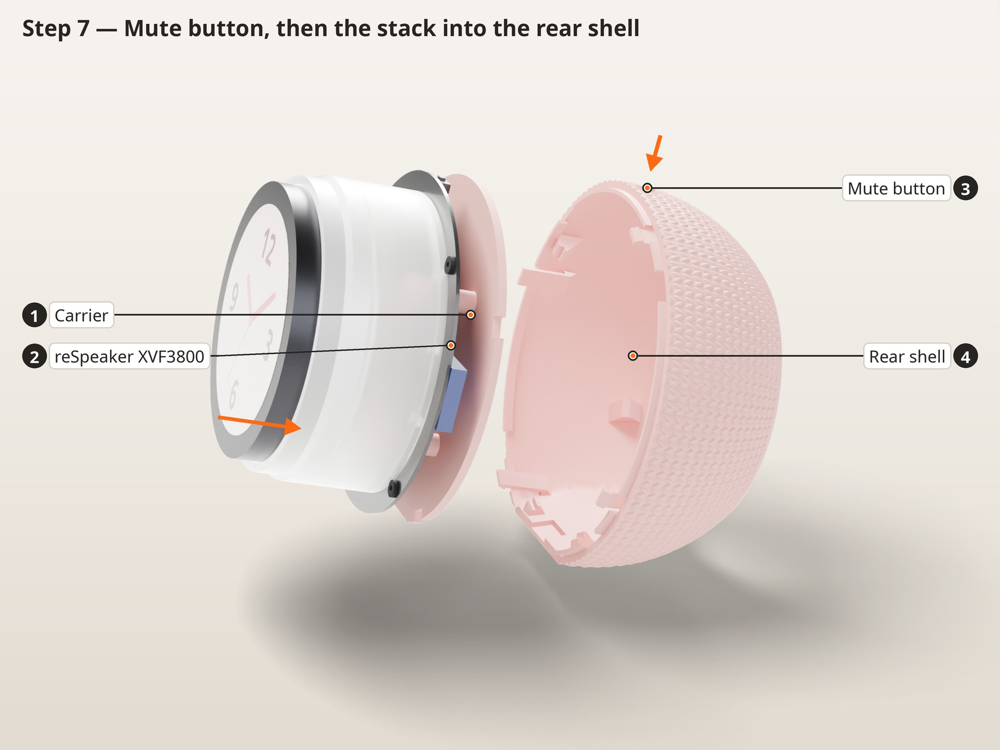

In this picture: **1** Carrier, **2** reSpeaker XVF3800, **3** Mute button, **4** Rear shell

1. Push the mute button into the hole at the top of the rear shell from the outside until its barb clicks past the inside of the guide boss. It should slide in and out about 1 mm and not fall out.
2. Stand the rear shell on its back opening. Pass the speaker and the power leads out through the opening first.
3. Lower the stack in, display up, with the reSpeaker's mute button (A) under the plunger at 12 o'clock. The board edge drops into the four cradle ribs and sits on their pads. The main USB-C and audio jack end up at 9 o'clock seen from the front, in the widest part of the shell.
4. Lay the CrowPanel lead down the gap between the board edge and the shell wall at 10 o'clock, then through the carrier notch.

> **Check:** The board sits flat on all four pads and can't shift sideways. Pressing the mute button clicks the reSpeaker's mute switch (once it's powered, the LED ring turns red).

## 8. Snap on the front shell

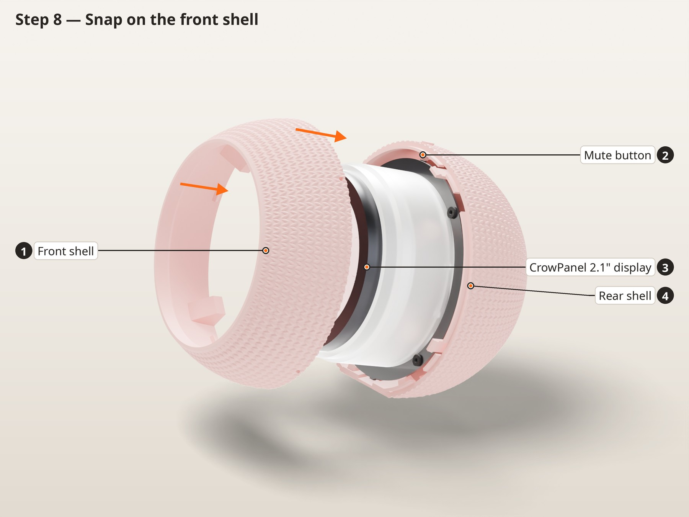

In this picture: **1** Front shell, **2** Mute button, **3** CrowPanel 2.1" display, **4** Rear shell

1. Lower the front shell over the knob. The four mic boots inside it only line up with the four gaps in the rear shell's rim lip one way round.
2. Press it down evenly. The four hooks in the rear shell click over the ridges inside the front shell, and the shell pushes the light guide down onto the reSpeaker's LED ring.
3. To open it again, hold both halves and pull them apart firmly. The hooks are angled to let go without a tool.

> **Check:** The seam is closed evenly all the way round and the flat base sits level. The knob stands about 7 mm proud of the face, turns and presses without rubbing, and the gap around it is even.

## 9. Speaker and USB-C on the back plate

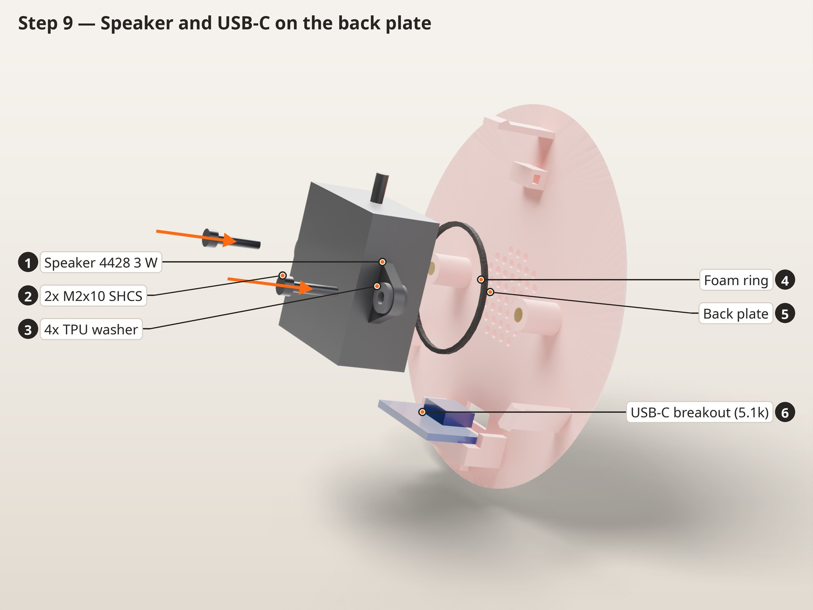

In this picture: **1** Speaker 4428 3 W, **2** 2x M2x10 SHCS, **3** 4x TPU washer, **4** Foam ring, **5** Back plate, **6** USB-C breakout (5.1k)

1. Stick a foam ring around the speaker's face.
2. The speaker stays plugged into the reSpeaker; work with the back plate next to the clock. Set a TPU washer on each speaker boss, place the speaker with its face toward the round grille and its lead toward the top, then add a washer on top of each ear.
3. Fit 2 × M2 × 10. Snug only: the washers do the isolation, so don't crush them.
4. Stand the USB-C breakout on its USB edge with the socket in the slot, board against the backing wall, and fit 2 × M2 × 10 through its holes into the wall. Zip-tie the speaker lead to the anchor.

> **Check:** A USB-C cable plugs in fully from outside, and the speaker doesn't touch the plate anywhere except the foam and washers.

## 10. Snap in the back plate

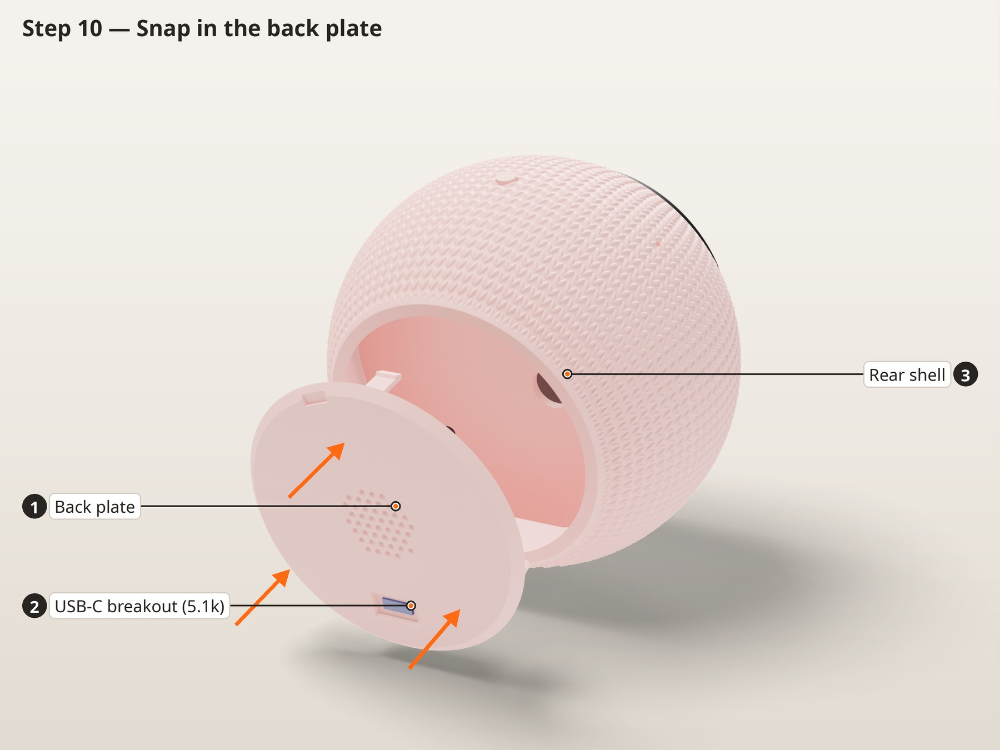

In this picture: **1** Back plate, **2** USB-C breakout (5.1k), **3** Rear shell

1. Plug the inlet's JST lead into the harness and tuck the wires clear of the speaker.
2. Line up the key tab on the back plate with the slot at the bottom of the rear opening (USB-C port at the bottom).
3. Press the plate in until the three hooks click. To take it off, put a coin in the notch at the top edge and lever it out.

> **Check:** Plug in a 5 V 3 A charger. The clock face comes up and the LED ring lights. Then flash and set up the firmware.

## Finished

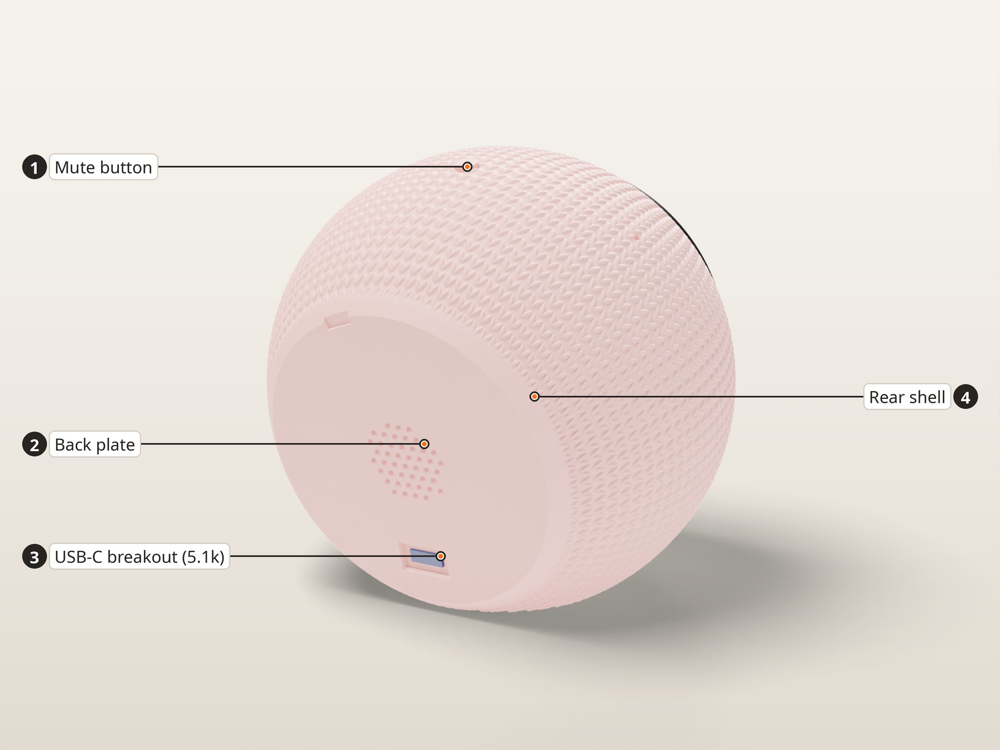

Flash the clock face with the ESPHome config in [`firmware/`](../../firmware), and the reSpeaker with the formatBCE XVF3800 ESPHome integration. Cap the speaker volume in ESPHome.
