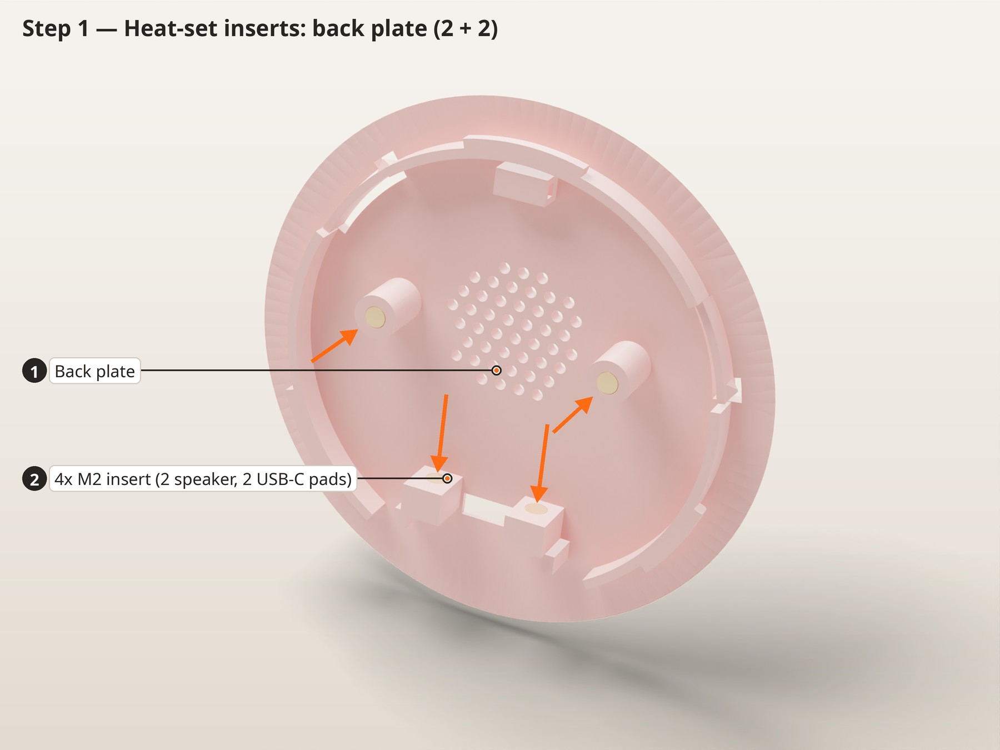
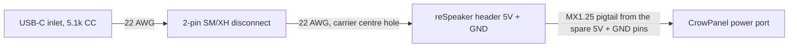
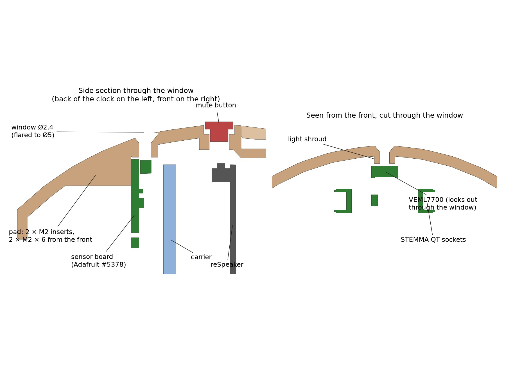
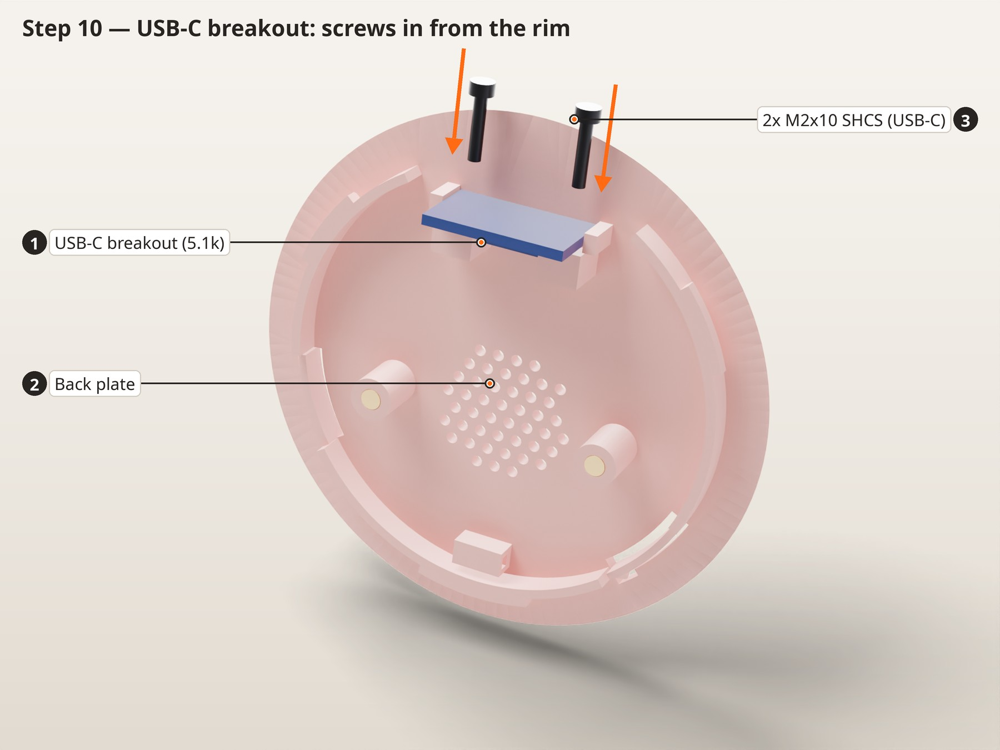
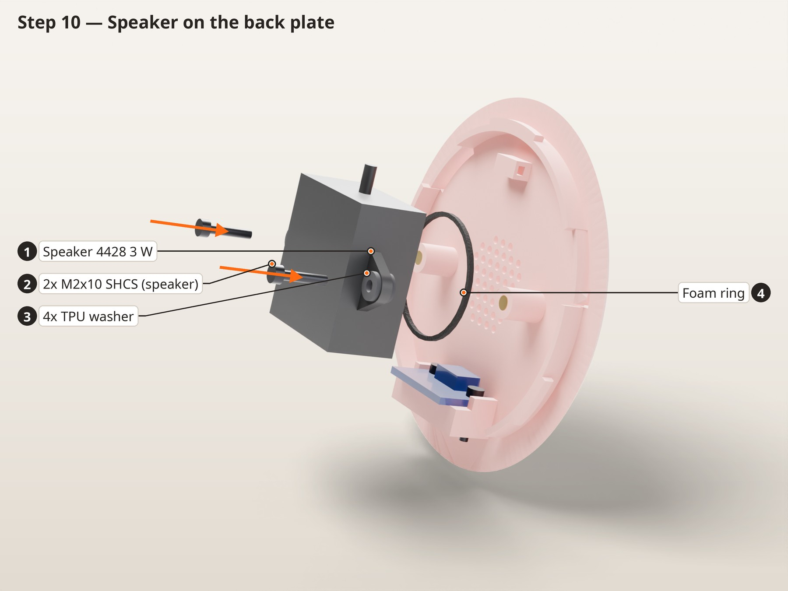
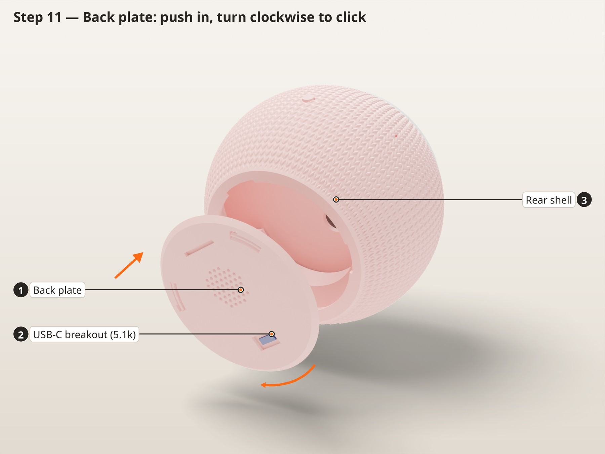

# Voice Clock assembly (v3)

> **v2, 6 Nov 2026.** The shells twist-lock, the stack is keyed, the light ring is a white-walled channel, the USB-C board and speaker screw into heat-set inserts, and a ballast pocket plus TPU grip pads keep the clock still when you turn the knob. **v3 (13 Nov 2026)** adds an ambient light sensor at the top of the rear shell (step 8). Pictures are rendered from `cad/` (the v3 sensor isn't in the pictures yet); this file is generated by `build_guide.py`.

## Before you start

| Plate | Parts | Material | Notes |
|---|---|---|---|
| 1 | Front shell, rear shell, back plate, mute button | Matte PLA, or the wood variant (print/wood/) | 5 mm brim on the shells, no supports. Front shell face-up (seam on the bed), rear shell on its back rim. |
| 2 | Carrier, spider bracket | The same matte PLA | A little stiffer than PETG and more accurate for the key notches and insert holes. Spider at 100% infill. |
| 3 | Ring base, ring shell, mute button | White PETG (slot 2) + natural or clear PETG (slot 1) | One print, two colours: the channel walls are white (they reflect the light, no foil), and only the ring shell's cap and the band above the case are natural, so it glows. No brim on the ring parts: it can't be peeled off their thin walls. Use this mute button rather than the PLA one: its snap barb is tougher in PETG. |
| 4 | 2 grip pads, 4 speaker washers | TPU | The grip pads stop the clock turning when you turn the knob. |

**Electronics:** Elecrow CrowPanel 2.1" rotary display; Seeed reSpeaker XVF3800 with XIAO ESP32-S3; 4428 3 W 8 Ω speaker; Adafruit #5378 right-angle VEML7700 light sensor; 5 V 3 A USB-C charger

**Tools:** Soldering iron with an M2 heat-set tip; Hex keys 1.5 and 2.5 mm; Multimeter; Wire strippers, flush cutters, heat gun; Craft knife; 5 mm and 2 mm hole punch

| Qty | Part | Where it goes |
|---|---|---|
| 3 | M3 × 12 socket head | Spider to the CrowPanel hub (replaces its 3 rear screws) |
| 3 | M2 × 20 socket head | Carrier, through the reSpeaker and the ring base's spacers, into the spider |
| 4 | M2 × 10 socket head | Speaker (2), USB-C breakout (2) |
| 2 | M2 × 6 socket head | Light sensor board (v3) |
| 9 | M2 heat-set insert (3 × 3.2 mm) | Spider 3, speaker bosses 2, USB-C pads 2, light-sensor pad 2 |
| 1 | USB-C breakout with 5.1 kΩ CC resistors | Power inlet on the back plate |
| — | 1/16" adhesive closed-cell foam | 4 mic gaskets, 1 speaker ring |
| about 160 g | Steel BBs or shot (4.5 mm airgun BBs) + slow-cure epoxy, or about 300 g tungsten putty | Ballast pocket in the rear shell |
| — | CA (superglue) | Grip pads |
| — | 22 AWG silicone wire, 2-pin JST-SM or JST-XH pair, MX1.25 4-pin pigtail, heat shrink, zip tie | Power harness (docs/wiring/WIRING.md) |
| 1 | Adafruit #5378 right-angle VEML7700 lux sensor (STEMMA QT) | Light sensor at the top of the rear shell (v3) |
| 1 | STEMMA QT / Qwiic (JST SH 4-pin) cable, 100–150 mm | Light sensor lead; one end cut off and soldered to the XIAO |

## 1. Heat-set inserts

In this picture: **1** 3x M2 insert, **2** Spider bracket

In this picture: **1** Back plate, **2** 4x M2 insert (2 speaker, 2 USB-C pads)

1. The M2 insert holes are Ø2.9, the size already confirmed on this printer. All 9 inserts go into PLA, so set the iron to about 190–200 °C.
2. Spider (first picture): 3 inserts in the underside at the end of each arm.
3. Back plate, speaker bosses (second picture): 2 inserts in the round bosses either side of the grille. The holes run deep on purpose: there is room below the screw tip for the plastic the insert pushes down.
4. Back plate, USB-C pads: the two small blocks either side of the USB-C slot. Press 1 insert into each **horizontally from the side facing the speaker bosses** (the face with the lead-in chamfer), flush with that face. The holes sit only 2.9 mm above the plate, so use a slim insert tip and tilt the iron a few degrees up off the plate, or prop the plate on a wedge. Support the pad from the slot side while you press.
5. Rear shell, light-sensor pad (v3): the flat-topped block inside the shell at 12 o'clock, just behind the mute button. With the shell standing on its back opening, its top faces straight up at you through the front: press 2 inserts in vertically, flush with the pad.

> **Check:** Run an M2 screw into each insert by hand. It should start straight and stop on the thread, not on plastic.

## 2. Power harness

1. Follow `docs/wiring/WIRING.md`.
2. Light sensor lead (v3): solder the cut end of the STEMMA QT cable to the XIAO's 3V3, GND, D4 (SDA) and D5 (SCL) pins on the back of the reSpeaker (WIRING.md sheet 05).
3. Leave about 30 mm of slack in the USB-C lead and the speaker lead: the back plate turns 32° when it locks.

> **Check:** With a multimeter, confirm 5 V and GND are not shorted. Power both boards on the bench and confirm they boot before anything goes into the case.

## 3. Spider bracket onto the CrowPanel

In this picture: **1** Spider bracket, **2** 3x M3x12 SHCS, **3** CrowPanel 2.1" display, **4** 3x M2 insert

1. Remove the three M3 screws from the hub on the back of the CrowPanel.
2. Fit the spider so its arms run between the three 4-pin connectors. Only one position leaves all the connectors clear.
3. Fit 3 × M3 × 12 and tighten them evenly. The holes are a close fit (Ø3.1), so the screws may need a gentle turn to start.

> **Check:** The knob still turns and clicks, and nothing touches the connectors.

## 4. Light ring, part 1 (ring base)

In this picture: **1** Ring base (white PETG), **2** CrowPanel 2.1" display, **3** Spider bracket

1. Plug the CrowPanel lead (the pigtail already soldered to the reSpeaker header) into the panel's power port.
2. Slide the ring base over the spider **from behind**, until its three spacers sit under the spider's insert pads. There is no cable notch: the lead stays inside the ring, between the spider arms.

> **Check:** The ring base sits square on the spider pads.

## 5. reSpeaker and carrier

In this picture: **1** reSpeaker XVF3800, **2** Ring base (white PETG), **3** Spider bracket

In this picture: **1** Carrier, **2** 3x M2x20 SHCS, **3** reSpeaker XVF3800

1. Lay the reSpeaker on the ring base's spacers, LED side toward the display, mute button (marked A) at 12 o'clock. The ring base's foot surrounds the LED ring; the CrowPanel lead stays inside it, flat in the gap between the board and the spider.
2. Feed the speaker lead and the reSpeaker power lead through the carrier's centre hole, the only wire opening. Set the carrier behind the board.
3. Fit 3 × M2 × 20 from the back of the carrier, through the board and the spacers, into the spider. **Snug only**: the screws pull the spider's inserts toward their mouths.

> **Check:** The board doesn't rock and no wire is pinched.

## 6. Light ring, part 2 (ring shell)

In this picture: **1** Ring shell (white + natural PETG), **2** Ring base (white PETG)

1. Press the ring shell on over the knob, with its two tabs in the ring base's slots. The skirt under its cap slides down round the top of the ring base, the crush ribs hold it, and the cap now covers the ring base's top edge, so no gap shows at the face.

> **Check:** Power the boards on the bench and set the LED ring white. The whole ring should glow evenly, with no bright gap round the knob and no LED visible.

## 7. Ballast and grip pads

In this picture: **1** Ballast: steel shot in slow epoxy, **2** TPU grip pad (large), **3** Rear shell

1. Stand the rear shell on its back opening. Inside, along the bottom, a thin curved wall forms a pocket between itself and the shell, open at the top.
2. **Steel shot:** mix a small batch of **slow-cure** epoxy (30 minutes or longer), stir in steel BBs, and spoon it into the pocket. Fill to about 1 mm below the pocket's rim, in two layers a few hours apart. A thick pour of fast epoxy gets hot enough to soften PLA (about 55 °C). **Tungsten putty:** press it in, then skim the top with a little epoxy so it can't move.
3. Let it cure fully before the stack goes in: the carrier sits 2 mm above the rim.
4. Glue the two TPU grip pads into the shallow recesses in the flat base (the large one on the rear shell, the small one on the front shell) with a few drops of CA.

> **Check:** Nothing stands above the pocket's rim, and the pads sit flat in their recesses.

## 8. Light sensor (v3)

1. Stand the rear shell on its back opening. Lower the sensor board in through the front, held a little toward the middle (its corners are just wider than the bayonet collar), and lay it on its pad at 12 o'clock, parts up, the white VEML7700 at the edge facing the small window in the shell wall. The board's two holes next to that edge sit over the inserts.
2. Fit 2 × M2 × 6 with a 1.5 mm hex key straight down through the front opening. Snug only: it's a 2 g board.
3. Plug the STEMMA QT lead into the board's socket on the right (seen from the front, the XIAO side).

> **Check:** Look in through the window from outside: you should see the sensor's white face filling the hole.

## 9. Into the rear shell

In this picture: **1** Carrier, **2** reSpeaker XVF3800, **3** Mute button, **4** Rear shell

1. Push the mute button into the hole at the top of the rear shell from outside until its barb clicks.
2. Stand the rear shell on its back opening and pass the speaker and power leads out through it.
3. v3: lay the light-sensor lead into the notch in the carrier's rim at about 1 o'clock (seen from the front) so it can't be pinched against the shell wall.
4. Lower the stack in, display up, mute button (A) under the plunger. The carrier's 4 notches (with lead-in chamfers) slide down over the 4 ribs on the shell wall, and the board edge lands on the rib pads. It only goes in one way.

> **Check:** The stack can't turn at all.

## 10. Front shell (twist lock)

In this picture: **1** Front shell, **2** 4x foam mic gasket, **3** Rear shell

1. Stick a foam gasket (Ø5 with a Ø2 hole) onto the underside of each of the 4 mic boots inside the front shell, hole over the channel. In v2 the gaskets ride on the shell, not on the board.
2. Hold the front shell over the knob turned about 10° **anticlockwise** (seen from the front) from its final position. The base flats are then a finger's width apart. Lower it until the rims meet; it only drops fully in that one position.
3. Turn it **clockwise** (seen from the front) about 10° until four small detent fingers click and it stops. The flat bases now line up.
4. To open it: turn the front shell anticlockwise about 10° (firmly, past the clicks) until the flat bases are offset by a finger's width, and lift it off.

> **Check:** The seam is closed all the way round, the flat bases line up, and the shells don't turn or pull apart by hand.

## 11. USB-C and speaker on the back plate

In this picture: **1** USB-C breakout (5.1k), **2** Back plate, **3** 2x M2x10 SHCS (USB-C)

In this picture: **1** Speaker 4428 3 W, **2** 2x M2x10 SHCS (speaker), **3** 4x TPU washer, **4** Foam ring

1. Stand the USB-C breakout on its USB edge with the socket down through the slot, socket side against the two pads (the socket sits between them). Its plain back faces the plate's rim.
2. Fit 2 × M2 × 10 from the **rim side**: through the board's holes into the pads' inserts. The hex key comes straight in over the plate from its edge, so a short key is easiest. The first picture shows the plate turned round, with the rim at the top.
3. Stick a foam ring round the speaker's face. Washer, ear, washer on each boss, then 2 × M2 × 10, snug only.
4. Zip-tie the speaker lead to the anchor.
5. The USB-C screws stay reachable from the rim, so the board can come off later without removing the speaker.
6. The speaker sits 6 mm off-centre, toward the anchor, which leaves about 16 mm between the USB-C board and the speaker for the board's JST plug and its lead.

> **Check:** A USB-C cable plugs in fully from outside, and the speaker touches the plate only through the foam and washers.

## 12. Back plate (twist lock)

In this picture: **1** Back plate, **2** USB-C breakout (5.1k), **3** Rear shell

1. Plug the inlet's lead into the harness and tuck the wires clear of the speaker.
2. Hold the plate so the USB-C socket is at about 5 o'clock seen from the back. The three lugs only drop through the lip in that position (the top lug is the wide one).
3. Push it in and turn it **clockwise** (seen from the back) about one clock hour, until both pawls click and it stops with the USB-C at 6 o'clock.
4. To open it: put a coin in the slot on the back and turn it anticlockwise, seen from the back, past the two pawl clicks.

> **Check:** Plug in a 5 V 3 A charger. The clock face comes up and the LED ring lights.

## Finished

## Firmware

Flash the clock face with the ESPHome config in `firmware/`, and the reSpeaker with the formatBCE XVF3800 integration. Cap the speaker volume (the runaway follow-up loop seen on 6 Nov ran at 100 %). The v2 spider turns the CrowPanel 5° clockwise to cancel the tilt seen on v1; the firmware has no trim, so check the dial by eye. If 12 still sits X° anticlockwise, change `CP_ROT_TRIM_DEG` in `cad/voice_clock.py` by -X° and reprint the spider.
