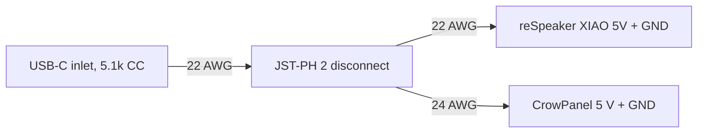

# Voice Clock assembly

## Before you start

| Plate | Parts | Material | Notes |
|---|---|---|---|
| 1 | Front shell, rear shell | Matte PLA | 5 mm brim, no supports. Shells print face-down and rim-down. |
| 2 | Carrier, back plate, spider bracket, mute button, 3 spacers, insert test block | Matte PLA | Print this plate first. Spider and spacers at 100% infill. |
| 3 | Light guide | Clear or natural PETG | 100% infill for an even glow. Bezel face down. |
| 4 | 4 speaker washers (optional) | TPU | Or use M2 rubber washers. |

**Electronics:** Elecrow CrowPanel 2.1" rotary display (ESP32-S3); Seeed reSpeaker XVF3800 4-mic array with XIAO ESP32-S3; 4428 3 W 8 Ω speaker with JST-PH lead; 5 V 3 A USB-C charger

**Tools:** Soldering iron with M2 and M3 heat-set tips; Hex keys 1.5, 2.0 and 2.5 mm, plus a 2.0 mm driver with a 60 mm or longer shaft; Multimeter; Wire strippers, flush cutters, heat gun or lighter; Tweezers, craft knife, 5 mm and 2 mm hole punch (or scissors)

| Qty | Part | Where it goes |
|---|---|---|
| 3 | M3 × 12 socket head | Spider to the CrowPanel hub (replaces its 3 rear screws) |
| 3 | M2 × 20 socket head | Carrier through the reSpeaker into the spider |
| 3 | M3 × 6 socket head | Carrier rim to the front shell |
| 6 | M3 × 8 button head | Rear shell to the carrier (3), back plate to the rear shell (3) |
| 2 | M2 × 10 socket head | Speaker |
| 9 | M3 heat-set insert (4 × 4.2 mm) | Front shell 3, carrier 3, rear shell 3 |
| 5 | M2 heat-set insert (3 × 3.2 mm) | Spider 3, back plate 2 |
| 1 | USB-C breakout with 5.1 kΩ CC resistors | Power inlet, glued into the back plate |
| — | 1/16" adhesive closed-cell foam | 4 mic gaskets, 1 speaker ring |
| — | 22 and 24 AWG silicone wire, JST-PH 2-pin pair, heat shrink, zip tie, 5-minute epoxy | Power harness |

## 1. Heat-set inserts

In this picture: **1** 3x M3 insert, **2** Rear shell, **3** 3x M3 insert, **4** Back plate, **5** 3x M3 insert, **6** Front shell, **7** Spider bracket, **8** 3x M2 insert, **9** Carrier

1. Print the insert test block from plate 2 first. Set one insert in each hole and note which hole (1, 2 or 3 dots) holds best. The middle one is the default; if another fits better, change the hole size in `cad/voice_clock.py` and reprint.
2. Set the iron to 190–200 °C for PLA. Press each insert straight in until it is flush, then hold a flat tool on it for a few seconds while it cools.
3. Front shell: 3 × M3 in the lugs just inside the split. Carrier: 3 × M3 from the back face (use inserts 5 mm long or shorter here). Rear shell: 3 × M3 in the lugs at the back opening.
4. Spider: 3 × M2 in the underside at the end of each arm. Back plate: 2 × M2 in the speaker bosses.

> **Check:** Run a screw into each insert by hand. It should start straight and stop on the thread, not on a blob of plastic.

## 2. Power harness

1. Solder 10 cm of 22 AWG red and black to the USB-C breakout's VBUS and GND pads, and finish them in one half of a JST-PH 2-pin pair. This lead stays with the back plate.
2. Solder the other JST-PH half to a short split: one 22 AWG pair to the XIAO's 5V and GND pins on the back of the reSpeaker, one 24 AWG pair to the CrowPanel's 5 V and GND (splice into the cable that came with it, or a lead into its 4-pin connector after checking the pinout with a multimeter).
3. Cover every joint with heat shrink and strain-relieve the solder joints so a tug never loads a pad.
4. Plug the speaker lead into the reSpeaker's speaker socket. It runs through the carrier's centre hole later.

> **Check:** With a multimeter, confirm 5 V and GND are not shorted. Power both boards on the bench and confirm they boot before anything goes into the case. Never plug a laptop into either board while the USB-C inlet is powered.

## 3. Spider bracket onto the CrowPanel

In this picture: **1** Spider bracket, **2** 3x M3x12 SHCS, **3** CrowPanel 2.1" display, **4** 3x M2 insert

1. Remove the three M3 screws from the hub on the back of the CrowPanel.
2. Fit the spider so its hub sits on the CrowPanel hub. Turn it so its arms run between the three 4-pin connectors; only one of the three screw positions leaves all the connectors uncovered.
3. Fit 3 × M3 × 12 from the spider side into the hub. Tighten evenly until snug.

> **Check:** The knob still turns and still clicks when pressed, and nothing touches the connectors.

## 4. Light guide from behind

In this picture: **1** Light guide (PETG), **2** CrowPanel 2.1" display, **3** Spider bracket

1. Slide the light guide over the spider from behind and onto the display. Its inner lip is smaller than the knob, so it only goes on this way. It stops when the lip meets the back of the display housing and stays loose for now: the front shell pushes it back onto the reSpeaker in step 7.
2. Turn it so its cable notch sits over the CrowPanel power wires, lower left seen from the front.
3. Punch four foam rings (5 mm across with a 2 mm hole) and stick one over each microphone hole on the front of the reSpeaker, on its four diagonals.

> **Check:** The light guide turns freely around the knob ring with an even gap all round.

## 5. Spacers and reSpeaker

In this picture: **1** 3x printed spacer, **2** reSpeaker XVF3800, **3** Light guide (PETG)

1. Set the three printed spacers on the spider's M2 inserts.
2. Lay the reSpeaker on the spacers with its LED ring and foam gaskets facing the display. The mute button (marked A) goes at 12 o'clock and the RST button at 6 o'clock; the XIAO module then sits at 3 o'clock seen from the front.
3. Keep the CrowPanel wires in the light guide's notch.

> **Check:** All three reSpeaker mounting holes line up with the spacers, and no wire is trapped under the light guide.

## 6. Carrier and clamp screws

In this picture: **1** Carrier, **2** 3x M2x20 SHCS, **3** 3x M3 insert, **4** reSpeaker XVF3800

1. Feed the speaker lead through the carrier's centre hole.
2. Set the carrier behind the reSpeaker with its cable notch lined up with the light guide's notch (lower left seen from the front, lower right seen from the back).
3. Fit 3 × M2 × 20 from the back of the carrier, through the board and spacers, into the spider inserts. Tighten in turn until snug.

> **Check:** The board doesn't rock and no wire is pinched.

## 7. Into the front shell

In this picture: **1** Carrier, **2** 3x M3x6 SHCS, **3** Mute button, **4** Front shell

1. Drop the mute button into the hole at the top of the front shell, cap outside.
2. Slide the whole stack into the front shell from behind, knob first. The shell's bezel ring pushes the light guide back until it sits flat on the reSpeaker, lip over the LED ring. Push on until the carrier rim sits on the three lugs.
3. Fit 3 × M3 × 6 through the carrier rim into the lug inserts.

> **Check:** Pressing the mute button clicks the reSpeaker's mute switch. The knob stands about 7 mm proud of the face and still presses.

## 8. Rear shell

In this picture: **1** 3x M3 insert, **2** Rear shell, **3** 3x M3x8 button head, **4** Front shell

1. The speaker is still hanging on its lead: pass it out through the rear shell's back opening first.
2. Fit the rear shell to the front shell so its three inner ribs land on the carrier's inserts.
3. Reach through the open back with the long 2.0 mm driver and fit 3 × M3 × 8 button head through the ribs.

> **Check:** The seam between the shells closes evenly all the way round.

## 9. Speaker and USB-C on the back plate

In this picture: **1** Speaker 4428 3 W, **2** 2x M2x10 SHCS, **3** 4x TPU washer, **4** Foam ring, **5** Back plate, **6** USB-C breakout (5.1k)

1. Stick a foam ring around the speaker's face.
2. The speaker stays plugged into the reSpeaker; work with the back plate next to the clock. Set a TPU washer on each speaker boss, place the speaker with its face toward the round grille and its lead toward the top, then add a washer on top of each ear.
3. Fit 2 × M2 × 10. Snug only: the washers do the isolation, so don't crush them.
4. Glue the USB-C breakout into its pocket with 5-minute epoxy, receptacle in the slot. Keep a cable plugged in while it cures to hold it square. Zip-tie the speaker lead to the anchor.

> **Check:** A USB-C cable plugs in fully from outside, and the speaker doesn't touch the plate anywhere except the foam and washers.

## 10. Close up

In this picture: **1** 3x M3x8 button head, **2** Back plate, **3** USB-C breakout (5.1k), **4** Rear shell

1. Plug the inlet's JST lead into the harness and tuck the wires clear of the speaker.
2. Fit the back plate with the grille over the speaker and the USB-C port at the bottom.
3. Fit 3 × M3 × 8 button head.

> **Check:** Plug in a 5 V 3 A charger. The clock face comes up and the LED ring lights. Then flash and set up the firmware.

## Finished

Flash the clock face with the ESPHome config in [`firmware/`](../../firmware), and the reSpeaker with the formatBCE XVF3800 ESPHome integration. Cap the speaker volume in ESPHome.
