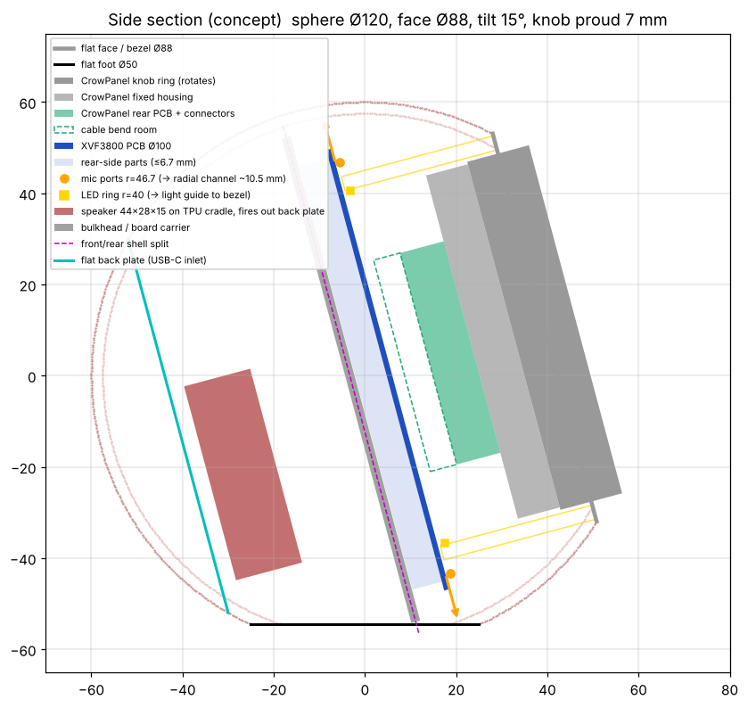

# Voice Clock: Design and Build Plan

*Written 31 Oct 2026 from the vendor documentation and STEP models measured in code. The CAD in [`cad/`](../cad) is the source of truth where this plan and the model differ.*

> **v3 light-sensor variant (13 Nov 2026), UNTESTED and optional; the default build stays v2.** An Adafruit #5378 right-angle VEML7700 (STEMMA QT, about $5, Adafruit publishes its STEP) lies flat on a pad at 12 o'clock in the rear shell, behind the carrier, with the sensor against a Ø2.4 window 15° behind vertical. **Why not the CrowPanel's I2C port:** the light ring's walls run from the reSpeaker to the face and enclose the CrowPanel's connectors, so a lead to it would have to pierce the ring (a dark spot, which v2 removed) or the reSpeaker. Instead the sensor shares the XIAO's I2C bus with the XVF3800, the lead stays behind the board (through a notch in the carrier's rim), and the lux value reaches the clock through HA, like the sun and lamp states the night mode already used. Facing up and back keeps the display and light ring out of its view. See `cad/README.md`, `docs/wiring/WIRING.md` sheet 06 and `firmware/README.md`.
>
> **v2 update (6 Nov 2026), after printing v1 in wood PLA.** v1 fitted, but it wasn't secure: the shells pulled apart, the back plate turned and fell out, the stack could turn in the rear shell with the front shell off, the USB-C board's self-tapping screws didn't hold, and the speaker screws bottomed out. The light ring barely glowed: a ray trace puts the v1 guide at about 0.4 % efficiency, because 35 mm of solid FDM PETG scatters at every layer and the LED pocket leaked inward. The wood-grain temperature drift was invisible. The CAD (`cad/voice_clock.py`) is again the source of truth. What changed:
>
> | | v1 | v2 |
> |---|---|---|
> | Front ↔ rear shell | 4 pull-apart snap hooks | **7-lug bayonet.** The front shell turns 10° clockwise (seen from the front) to lock, on flat bearing faces. Four flexure detent fingers click it in place; stop posts end the travel |
> | Back plate | 3 snap hooks + key | **3-lug bayonet** into a lip, turned 32° clockwise (seen from the back), with 2 flexure pawls and a hard stop |
> | Stack in the case | Centred only; nothing keyed it | **Keyed.** The 4 cradle ribs run down the wall into carrier notches (0.2 mm per side). Spider M3 holes are Ø3.1 |
> | Dial angle | v1 dial sat ~5° anticlockwise (one photo, ±2°): a fixed offset in Elecrow's panel or the print, not play (the CAD chain is exact) | v2 at −5° overshot: the dial sat 2.2° clockwise (level photo, 12 Nov). The spider now turns the CrowPanel pattern −2.8° (`CP_ROT_TRIM_DEG`). The firmware has no trim; judge by eye and adjust that one number |
> | Front face | Flat bezel; shell printed face-down (rough) | **No flat face.** The sphere runs to the ring and the front shell prints **face-up** |
> | Light ring | Solid PETG tube at 100 % infill | **Hollow channel with white PETG walls** (foil tape dropped 11 Nov 2026: too fiddly, and it ate the tolerances). The inner wall carries the 3 board spacers on the clamp screws; the sleeve and diffuser cap stand 2.35 mm proud of the sphere. Modelled at roughly 50–80 × brighter |
> | USB-C board | Self-tapping into a 4 mm wall | **2 horizontal M2 heat-set inserts** in 2 pads on the socket side. The screws go in from the rim side, where a short hex key reaches them |
> | Speaker | 0.9 mm below the screw tip | **4.4 mm below the tip** (the hole runs into the plate) |
> | Wood variant | Per-layer ±9 °C drift; all wood PLA | **Fixed temperatures**: cool and hot cherry heads plus walnut cores, on a **plain-PLA core**; new ring model; no relief |
>
> Hardware now: 3 × M3 × 12, 3 × M2 × 20, 4 × M2 × 10, 7 M2 inserts. The assembly guide is in `docs/assembly/ASSEMBLY.md`.

> **v1 update (5 Nov 2026), after the first full print.** The CAD is the source of truth. What changed from the plan below:
>
> | | v0 (below) | v1 |
> |---|---|---|
> | Sphere | Ø120 | **Ø116**, 109 mm tall, 88 mm deep incl. knob |
> | Flat base | Ø42 | **Ø54** (limited by the reSpeaker's reset button at 6 o'clock, which pokes out to r 51.6) |
> | Shell split | 14.5 mm behind the board; the stack slid into the front shell past the floor | **1 mm in front of the board.** The stack drops into the rear shell onto 4 cradle ribs (centring face r 50.15, pads under the PCB back), then the front shell snaps on over the knob |
> | Shell joints | 3 × M3 × 6 carrier rim, 3 × M3 × 8 rear ribs, 3 × M3 × 8 back plate, 9 M3 inserts | **Snap hooks:** 4 front↔rear (keyed by the mic boots), 3 back plate (keyed at 6 o'clock). 45° faces, so both pull apart by hand. No M3 inserts left |
> | Board clamping | Carrier screwed to the front shell | Front shell → light guide → board front; cradle pads on the board back. The carrier now hangs on the 3 M2 clamp screws only (bulkhead + wire organiser) |
> | Mute plunger | Front shell, stopped at r 53.75, z −0.6 (3.5 mm short, 2.4 mm high) | **Rear shell**, on the measured BUTA nub (r 50.23, z −3.75 to −2.2), 0.25 mm rest gap, 1 mm travel, 5 mm guide boss |
> | Knob gap | 0.75 mm | **0.45 mm**; the light guide centres on the CrowPanel's fixed housing (land Ø78.4 on Ø77.9) |
> | Cable notch | 195° (on an LED, over the 3.5 mm jack) | **None** (9 Nov 2026). The CrowPanel is fed from the reSpeaker header's spare 5V / GND pins on the LED side, inside the light ring, so the ring, carrier and rear-shell collar have no cable notch or gap; the carrier's centre hole is the only wire opening |
>
> Hardware is now 3 × M3 × 12, 3 × M2 × 20, 4 × M2 × 10 and 5 M2 inserts. Sections 4 and 4b below describe v0's screws and are kept for the reasoning; the wiring now runs USB-C → disconnect → reSpeaker header → CrowPanel ([`wiring/WIRING.md`](wiring/WIRING.md)).

**Start here (10 min with calipers):**

1. Measure the speaker: length, width, depth, and where the sound opening is.
2. Measure the CrowPanel: knob ring OD, fixed rear housing OD, and total depth including the plugged-in cables.
3. Press the knob and watch which part moves (the whole front, or only the ring). This decides how the clamp works.
4. Find the speaker JST on the reSpeaker and count its pins (details in section 3).
5. Measure the reSpeaker's 3 mounting-hole diameters (section 2).
6. Measure the CrowPanel's 3 rear screws: pitch circle, thread, length, and where the rear connectors sit relative to them.
7. Check whether the speaker has mounting ears. If it does, measure the hole size and spacing.
8. With a multimeter (boards on bench USB), find the 5 V and GND solder points on each board:
   - **reSpeaker:** check whether feeding the XIAO 5V pin (or the main USB-C VBUS) powers both the XVF3800 and the XIAO.
   - **CrowPanel:** check whether the 4-pin UART connector (or the FPC) carries 5 V that can be used as an input.

The rest of this plan uses the numbers from the CAD files. Swap in your measurements wherever they differ.

---

## 1. The target

An open-source Home Assistant voice clock shaped like the reference photo: a sphere with a flat, slightly upturned front face, a light bezel ring around the display, and a knit fabric look all over.

**What changes from the earlier design notes:**

- **The knob sticks out.** The CrowPanel ring sits about 7 mm proud of the face so you can grip and turn it. The flat face (the bezel) surrounds it with a 0.75 mm gap.
- **The case is a sphere.** It's no longer a cylinder.
- **The bezel ring glows.** In v2 it's a white-walled hollow channel (ring base + ring shell) with a diffuser cap, lit by the reSpeaker's LED ring, which sits right behind the display edge.
- **Audio lives on the reSpeaker.** It does not go on the CrowPanel (section 3). That closes the open audio question in [crowpanel-esphome-notes.md](crowpanel-esphome-notes.md).



*Concept side section, drawn to scale from the parameters below. The mic arrows show the radial channel length. The real mics sit on the diagonals, not in this section plane.*

---

## 2. What the files actually say (measured from the STEP models)

### reSpeaker XVF3800 + XIAO (`respeaker_mic_array_xvf3800_1_with-xiao-0820.stp`)

| Feature | Location (board centre = 0,0; XIAO at 12 o'clock) | Side |
|---|---|---|
| PCB | Ø100 mm (plus edge parts to about r = 53.6), 1.1 mm thick | n/a |
| **4 mics** (Infineon IM69D130, bottom-port) | (±33, ±33) mm, so **r = 46.7 mm on the 45° diagonals** | Mounted on the back. Sound enters through PCB holes from the **front (LED) side**. |
| **12 LEDs** (WS2812B-2020) | Ring at **r = 40.0 mm**, every 30° | Front |
| XIAO ESP32-S3 | 12 o'clock edge, 18 × 22 mm, 4.5 mm tall | Back |
| Main USB-C | 6 o'clock edge | Edge, mostly back |
| 3.5 mm jack | About 5 o'clock (15, −43), 5.5 mm tall | Back |
| 4-pin JST-PH header | 9 o'clock (−43, −15), 6.7 mm tall | Back |
| 2 side buttons (mute and reset) | 3 and 9 o'clock edges, pushed from the side | Edge |
| **3 mounting holes** | (±21.35, +24.5) and (0, −34). All are inside the LED ring (r = 32–34). Seeed's own enclosure (`1-up.stp`) has Ø3.7 posts at exactly these spots. Diameter isn't in the files, so **measure it** (looks about Ø2.2–2.7). | Through |

**What this means for the design:**

- The front of the board is almost flat (2 mm max). Everything tall is on the back (6.7 mm max). So the board faces **forward**, LEDs and mic ports toward you, with a 7–8 mm zone behind it for its parts.
- The 66 × 66 mm square on Seeed's 2D drawing is the mic pattern. Seeed's wiki agrees: its example mic coordinates are ±0.033 m.
- The mics are at r = 46.7. The display is at r = 39.5. The mics clear the display footprint by 7 mm. ✅
- The LEDs are at r = 40, right at the display's edge. Behind a 79 mm display they'd be hidden, which is why they feed the bezel light ring.

### CrowPanel 2.1" (`00-irad-21.stp`)

| Part | Diameter | Depth (from knob front) |
|---|---|---|
| Rotating knob ring | Ø79.0 | 0 – 14.0 mm |
| Fixed housing | Ø77.9 | 14.0 – 23.5 mm (about 9.5 mm exposed behind the ring) |
| Rear PCB, connectors, buttons | Ø48 | 23.5 – 33.4 mm |

- The rear PCB has three 4-pin 1.0 mm connectors and a 14-pin FPC, all facing backward, plus reset and boot buttons.
- There are no external mounting holes. **Mount it by its 3 rear M3 screws** (an `M3X` part in the STEP). They're on a 120° pattern at **r = 5.95 mm** and screw into a central **Ø16.8 hub** that passes through a Ø17 hole in the rear PCB. The hub's rear face sits 0.5 mm behind the PCB, 27.4 mm behind the knob front.
  - The bracket boss bears on that hub. Swap the screws for **M3 × 12** (the spider boss adds 9.5 mm; the originals engage about 3.5 mm). Section 4b has the details.
  - **Check this:** with the panel held only by these screws, the knob still presses and turns. That would mean the hub is part of the fixed side.
  - The rear connectors don't conflict with the bracket. Two 4-pin connectors sit at the top, one 4-pin on the right (seen from the front), the reset and boot buttons on the left, and the 12-pin FPC on the right edge. Everything ends 33.4 mm behind the knob front.
- **No clamp collar.** A collar around the Ø77.9 housing (out to r ≈ 42 with TPU) takes the same space as the light-guide tube (r = 40.5–43.5).
- Allow about 6 mm behind the connectors for plugs and the cable bend.

### Other files

- `1-up.stp` / `1-down.stp`: Seeed's flat puck enclosure, Ø116. It's useful for checking how they handled mic holes and LED diffusion. The geometry isn't reusable for a sphere.
- `FCC_Report.pdf`: the FCC grant for the CrowPanel (FCC ID 2BDNA-AP05). Nothing in it affects the build. Its co-location note only matters if you ever sell assembled units.
- `esp32-s3_datasheet_en.pdf`: reference only.
- The vendor STEPs are not redistributed here; download them from Seeed and Elecrow (links under Sources).

---

## 3. Electronics architecture

**Two ESPHome devices in one shell, both talking to Home Assistant:**

| Device | Job | Firmware |
|---|---|---|
| XVF3800 + XIAO ESP32-S3 | Voice satellite: wake word, mics, echo cancellation, speaker, LED ring, mic mute | ESPHome config from `formatBCE/Respeaker-XVF3800-ESPHome-integration`, the one Seeed's HA wiki uses. Update the XMOS firmware first. |
| CrowPanel | Clock face (LVGL), knob, touch, backlight | Elecrow ESPHome lessons 02–05, then a custom analog clock face |

**Why this split:** the XVF3800 drives its own speaker amp, so echo cancellation gets a clean internal reference. Putting audio on the CrowPanel would need an extra I2S amp and spare GPIOs, and it would break echo cancellation.

**Power:** one 5 V USB-C inlet on the back plate. Wires are **soldered straight to both boards**, with no splitter board or pigtails. Full details are in section 4b.

- **Budget about 3 A peak:**
  - CrowPanel: about 1 A
  - Amp peaks: about 1.2 A
  - 12 LEDs at full white: up to 0.6 A
  - XIAO Wi-Fi: about 0.35 A
- Use a **5 V 3 A** supply.
- **Neither reSpeaker USB-C port is usable once it's in the case.** The board edge is about 4 mm from the shell wall, and a plug needs 15–20 mm. Do the first XIAO flash on the bench, then **OTA only**.

**Speaker:**

- The reSpeaker amp is rated for 5 W. Your speaker is rated for 3 W, so **cap the volume in ESPHome**.
- Seeed only says "JST speaker interface". The CAD shows a 4-pin JST-PH at 9 o'clock. If that's the speaker port, you'll need a 2-pin to 4-pin adapter lead, or you can re-crimp your 2-pin PH2.0 lead.

**Wi-Fi:** there are two radios in the case. Keep the XIAO's antenna (U.FL, if fitted) away from the CrowPanel's aluminium shell and stick it to the shell wall.

**HA glue (v1):**

- Knob turn → satellite volume
- Knob press → stop the alarm or timer
- Touch → snooze
- Voice timers → countdown arc on the clock face
- Night mode → backlight and LED ring dimmed on a schedule

---

## 4. Enclosure design

### Starting parameters (all in one parametric file)

| Parameter | Value | Why |
|---|---|---|
| Sphere OD | **120 mm** | Smallest size that fits the Ø100 board, its edge parts, and the 35 mm stack behind the face |
| Wall | 2.5 mm | Stiff enough for a fabric-texture skin |
| Flat face (bezel) OD | **88 mm** | 79 mm knob, 0.75 mm gap, about 3.75 mm bezel. Matches the reference photo's face-to-sphere ratio (0.73). |
| Face tilt | 15° up | Readable from the pillow |
| Knob proud of face | 7 mm | Half the 14 mm ring is grippable |
| Face plane to board front | 35 mm | 26.4 mm of display inside, plus 6.6 mm of cable bend |
| Flat foot | **Ø42** | Anti-roll. Cut down from Ø50 so the reSpeaker's 6 o'clock side button clears the floor while the board slides in. A 1 mm relief groove in the floor helps too. Final clearance is 3.1 mm, CAD-checked. |
| Overall | About 115 mm tall, 106 mm deep with the knob | Similar to a large alarm clock |

**Board rotation:** turn the reSpeaker −90° (clockwise seen from the front) so its mute button (marked A, confirmed on hardware) points straight up. A printed plunger through the top of the shell then gives you a physical mic-mute on top, like commercial speakers have. The mics stay on the diagonals, so all four channels exit above the foot.

### Parts

1. **Front shell:** the face plane back to the split. Print it face-down with no supports. The worst overhang at the face rim is 42.8°.
2. **Rear shell:** the split back to a flat back plate cut at 45° latitude (about Ø85). Print it standing on the back plate. It needs no supports because every overhang is at or under 45°.
3. **Back plate:** USB-C inlet, speaker grille, and screw bosses. It faces the wall, so the flat isn't seen.
4. **Board carrier and bulkhead:** sits behind the reSpeaker and screws to the front shell. 3 standoffs rise from it, pass through the reSpeaker's mounting holes, and carry the CrowPanel bracket (section 4b). It also seals the mic and LED zone off from the speaker zone.
5. **CrowPanel spider bracket:** a 3-arm bracket that screws to the CrowPanel's 3 rear screw points and sits on the standoffs. The arms run between the rear connectors and buttons, and everything stays inside r < 40, so nothing crosses the light guide.
6. **Bezel light guide:** natural PETG or clear PETG, sanded or frosted. It's a tube from the LED ring (r = 40) to the face, OD 87, ID about 81. Add an inward lip at the board end so it catches the LEDs, which sit half under the display edge. Use a white, reflective printed sleeve on the outside. Put **one 3–4 mm cable notch** in the lip, centred between two LEDs, for the CrowPanel power and UART wires.
7. **Mic channels (×4):** radial, about 10.5 mm long, 2–2.5 mm bore. Each one ends in a small hole on the shell "shoulder" just outside the face, hidden in the texture. Put a 0.5–1 mm foam or TPU gasket ring against the PCB. Keep the channels under about 12 mm so the tube resonance stays above the speech band.
8. **Speaker mount:** screwed to bosses on the back plate through rubber grommets, firing backward through the grille. That puts it as far from the mics as possible, with the bulkhead in between (section 4b).
9. **Mute plunger:** a printed plunger in a guide hole in the top of the shell, with a TPU flexure or spring to return it.

**Fasteners:** M3 heat-set inserts in the rear shell. Three screws come in from the back plate side, so no screws show on the sphere.

---

## 4b. Mounting, power and cable routing

### How each part is held (v0; v1 snaps together, see the top of this plan)

| Part | Method | Anti-rattle |
|---|---|---|
| reSpeaker | The holes are **Ø2.2 (M2)**, measured from Seeed's 1:1 drawing. 3 printed spacers sit between the board front and the spider. 3× **M2 × 20** go from the carrier back, through the carrier bosses, the board and the spacers, into M2 inserts in the spider's underside. The board is clamped between the spacers and the carrier bosses. | The mic gaskets press lightly on the board front. |
| CrowPanel | Its 3 rear M3 screws (r = 5.95, into the Ø16.8 hub) are swapped for **M3 × 12** that pass through the spider's hub boss. The spider is held by the same M2 × 20 clamp screws. | It's a rigid metal stack, so there's no plastic snap to buzz. |
| Carrier | 3× **M3 × 6 socket head** (counterbored) through its rim, into M3 heat-set inserts in 3 front-shell lugs (120/240/330°). Fit these before the rear shell goes on. | n/a |
| Rear shell | 3 inward ribs reach r = 38 (60/180/300°). 3× **M3 × 8** go straight in through the open back into M3 inserts in the carrier (5 mm-deep holes). | n/a |
| Speaker | 4428 3 W unit (28.2 × 31 × 15.3 body, ears Ø2.4 at 36.7 c-c, Ø26 diaphragm), modelled from its STEP. 2× **M2 × 10** through its ears into M2 inserts in back-plate bosses, with a **TPU washer on each side of each ear**. Bare screws would pipe vibration into the shell and the mics. | 1 mm closed-cell foam gasket between the speaker face and the grille. Zip-tie anchor for the lead. |
| Back plate | 3× M3 into the rear shell's heat-set inserts | n/a |

**One stack, front to back:**

```
CrowPanel hub ← 3× M3×12 ← spider (M2 inserts) ← printed spacers ← reSpeaker ← carrier bosses ← 3× M2×20
carrier rim ─ 3× M3 → front shell lugs;  rear shell ribs ─ 3× M3 → carrier;  back plate ─ 3× M3 → rear shell
```

Everything in this stack is inside r < 40. The light guide (r = 40.5–43.5) is free-standing between the face and the board, and the stack never crosses it.

**Depth budget (CAD-checked):** 8.6 mm from the CrowPanel's rear connectors to the reSpeaker front. That's the standoffs (5 mm) plus the spider plate (3 mm), with 0.6 mm to spare. The spider's arms route around all three 4-pin plug openings, so plugs and soldered leads exit freely.

### Power (soldered harness)

> **Wiring sheets (4 Nov 2026):** [`wiring/WIRING.md`](wiring/WIRING.md) supersedes the solder points below. The reSpeaker is fed at its 2×10 header (5V / GND, through-hole), the CrowPanel through a plug-in MX1.25 pigtail into its power port, and the disconnect is a JST-SM or JST-XH (JST-PH crimps don't take 22 AWG).

```
Back plate: USB-C panel breakout (5.1 kΩ CC) ─ 22 AWG ─┬─ reSpeaker 5 V / GND (XIAO 5V/GND pins if they feed the
                                                        │  whole board, else main USB-C VBUS/GND or a large cap / test pad)
                                                        └─ 24 AWG ─ CrowPanel 5 V / GND (UART connector pads or FPC
                                                                    5 V/GND pins, verify first)
```

- The USB-C breakout **must have 5.1 kΩ CC pull-downs**. Without them, a C-to-C charger supplies nothing.
- Use a 5 V 3 A supply. A 470 µF capacitor at the split point is optional, to cover amp peaks.
- Put a small JST or Dupont disconnect at the back plate so the shells can come apart.
- **Strain-relieve every solder joint** with hot glue or a printed cable clip on the carrier, so a pull on the cable never loads a pad.
- Before first power-up, check continuity and confirm there's no 5 V-to-GND short.
- **Back-feed rule:** unplug the inlet before plugging a laptop into either board.
- Run the CrowPanel UART TX/RX wires in the same bundle, ready for the v2 ESP-to-ESP link.

### Cable route

The CrowPanel's connectors are at r < 24, inside the light-guide tube, and the reSpeaker blocks the path backward. Route the CrowPanel wires like this:

1. Out through the light guide's cable notch (between two LEDs).
2. Over the reSpeaker's edge in a channel in the carrier.
3. Back to the back plate.

Put the notch where it's clear of the 4 mic channels (the diagonals), the 2 side buttons and the main USB-C. The reSpeaker's own power wires leave from its back side and don't need the notch.

### Hardware BOM

| Item | Qty |
|---|---|
| (no standoffs: printed spacers) | — |
| M3 × 12 socket-head screws (CrowPanel hub) | 3 |
| M2 × 20 SHCS (reSpeaker clamp), M3 × 6 SHCS (carrier rim), M3 × 8 button (rear-shell ribs) | 3 + 3 + 3 |
| M3 heat-set inserts (front-shell lugs ×3, carrier ×3, rear shell ×3) + M2 inserts (spider ×3, speaker bosses ×2) | 9 + 5 |
| M3 × 8 button head (back plate) | 3 |
| M2 × 10 screws, TPU washers (printed; speaker) | 2 + 4 |
| USB-C panel breakout with 5.1 kΩ CC resistors | 1 |
| 22 and 24 AWG silicone wire, small JST or Dupont disconnect | — |
| 1 mm closed-cell foam (speaker gasket), 0.5–1 mm foam or TPU (mic gaskets) | — |
| 470 µF / 10 V capacitor (optional) | 1 |

### The fabric look (pick one)

- **A. Printed texture (do this for v1):** model a small knit-like or hex perforation pattern as real geometry in CAD. Keep it open (sound passes) over the speaker and mic zones, and closed elsewhere. One material, no assembly, and fast to iterate.
- **B. Real stretch knit over a printed skeleton (v2):** this matches the photo best. Print the shells as open lattices and wrap them in stretch jersey or speaker knit. Trap the edges under the bezel ring and the back plate. The fabric is acoustically transparent, so the mic holes need no cosmetic hiding.

---

**CAD status (31 Oct):** parametric model v0 is in [`cad/`](../cad/README.md). The interference checks pass and the U1 3MF plates are built. The speaker is modelled from its STEP, and the released print file is [`print/VoiceClock_U1.3mf`](../print/VoiceClock_U1.3mf).

## 5. Toolchain and open-source setup

- **CAD: build123d (Python, built on CadQuery/OpenCascade).** It imports the vendor STEPs directly for interference checks, every dimension above becomes a named parameter, it diffs cleanly in git, and it exports STEP and 3MF. OpenSCAD can't import STEP files, so you'd lose the fit checks.
- **Repo layout:** `cad/` (build123d source plus exported STEP and 3MF), `firmware/satellite/` and `firmware/clock/` (ESPHome YAML), `ha/` (automations and blueprints), `docs/` (this plan, BOM, assembly photos).
- **Licences:**
  - Hardware: CERN-OHL-S-2.0 (or -P if you want it permissive).
  - Firmware and YAML: MIT.
  - **Don't commit the Seeed or Elecrow STEP files** unless their terms allow it. Link to them and have the build script download them instead.

---

## 6. Build phases

| # | Phase | Output | Time |
|---|---|---|---|
| 1 | **Measure and verify** (the four checks at the top) | Updated parameter table | 30 min |
| 2 | **Bench electronics:** flash the XMOS firmware and the formatBCE ESPHome config. Get the wake word, the speaker, and an HA conversation working. Separately, flash the CrowPanel lessons 02–05. | Two working ESPHome devices, no case | 1 evening |
| 3 | **Parametric CAD v0:** sphere, face, carrier, standoffs, spider bracket, imported vendor STEPs. Run interference checks on: bracket vs. CrowPanel connectors, the 8.6 mm depth stack, cable notch vs. mics/buttons/USB-C, and the foot. | `cad/voice_clock.py` | 1–2 days |
| 4 | **Fit print:** carrier, spider bracket, and a thin front-shell ring only (no texture). Check the knob clearance, knob press, mic gasket seating, the cable route, and the solder-joint strain relief. | Fit-checked core | 1 evening + about 6 h of printing |
| 5 | **Full shell v1** (texture option A), light guide, speaker cradle | Complete prototype | About 2 days of printing |
| 6 | **Acoustic tuning:** compare wake-word range with the shell on and off. Check echo cancellation at max volume. Tap-test for buzzing. Set the volume cap. | Tuned v1 | 1–2 evenings |
| 7 | **Clock face UI and HA glue:** analog face like the photo, timers, alarms, night dimming | Daily-driver firmware | 2–3 evenings |
| 8 | **Publish:** README, BOM with links, print settings, assembly photos, release tag | Public repo v1.0 | 1 evening |

**Later (v2):** real fabric wrap, an optional UART link between the two ESPs for a local clock fallback when HA is down, and a custom antenna position.

---

## 7. Risks to watch

1. **Speaker vibration reaching the mics through the plastic.** This is the biggest acoustic risk. Defences: the TPU cradle, the bulkhead, and the speaker firing away from the mics. Test in phase 6.
2. **Knob press mechanics.** The rear-screw mount holds the fixed part, so the knob press should still work. Confirm in the measuring step that the press moves the knob relative to the rear PCB, not the whole unit.
3. **The foot is tight.** It clears the board edge by only about 1.7 mm. If CAD shows a clash, shrink the foot to Ø45 or move the board 2 mm forward.
4. **Light-guide efficiency.** The LEDs sit half under the display edge, so the bezel may glow unevenly. Print a 20 mm test arc before committing to the full ring.
5. ~~Speaker size conflict~~ Resolved by the speaker STEP: 43.5 × 31 incl. ears, 15.3 deep.
6. **Depth behind the CrowPanel.** There's only about 8.6 mm for the bracket, plugs and cable bends. If CAD shows a clash, move the reSpeaker 2–3 mm back (the sphere has room behind it) or solder the UART leads too.
7. **The cable notch dims one sector of the bezel glow.** Include the notch in the 20 mm light-guide test arc.
8. **Solder pads lifting.** A tug on the power cable can rip a pad off the board. The strain-relief clip is not optional.

---

## Sources

- Seeed: [reSpeaker XVF3800 + XIAO with Home Assistant](https://wiki.seeedstudio.com/respeaker_xvf3800_xiao_home_assistant/)
- Seeed: [Getting started with reSpeaker XVF3800](https://wiki.seeedstudio.com/respeaker_xvf3800_introduction/)
- HA Community: [ReSpeaker XMOS XVF3800 ESPHome integration](https://community.home-assistant.io/t/respeaker-xmos-xvf3800-esphome-integration/927241)
- CNX Software: [XVF3800 board with ESP32-S3 module](https://www.cnx-software.com/2025/07/29/respeaker-xmos-xvf3800-4-mic-array-board-features-esp32-s3-module-works-over-usb/)
- Vendor files (not included in this repo): the XVF3800 STEP and 2D drawing, the CrowPanel STEP (`00-irad-21.stp`), and Seeed's enclosure STEPs
