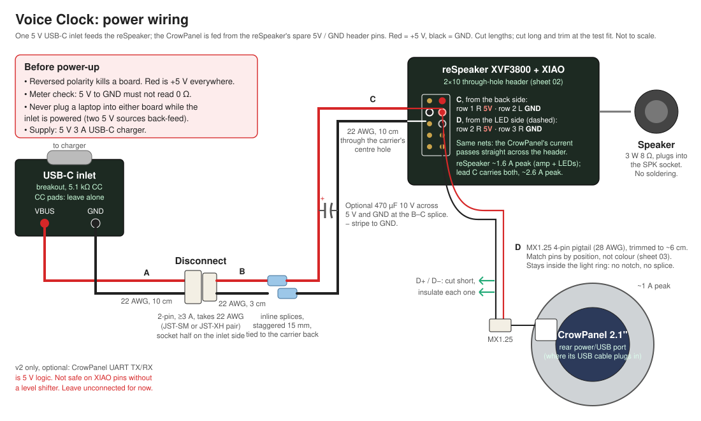
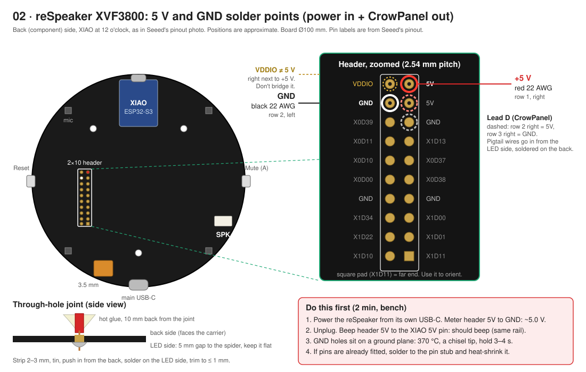
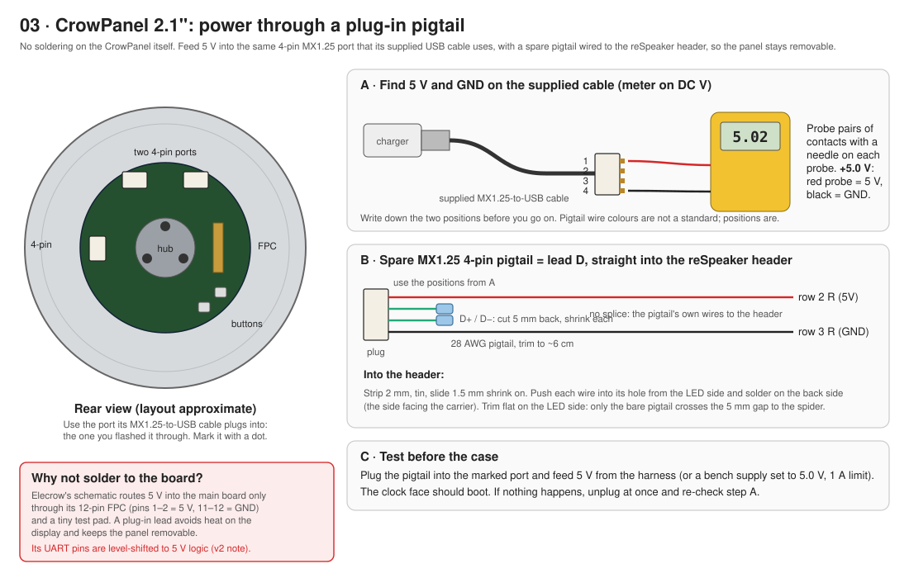
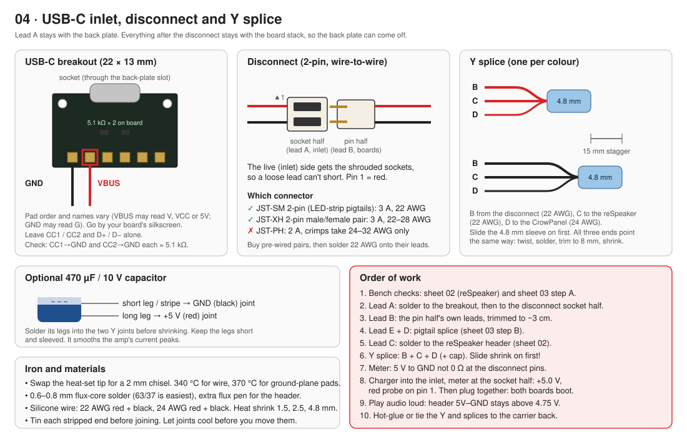
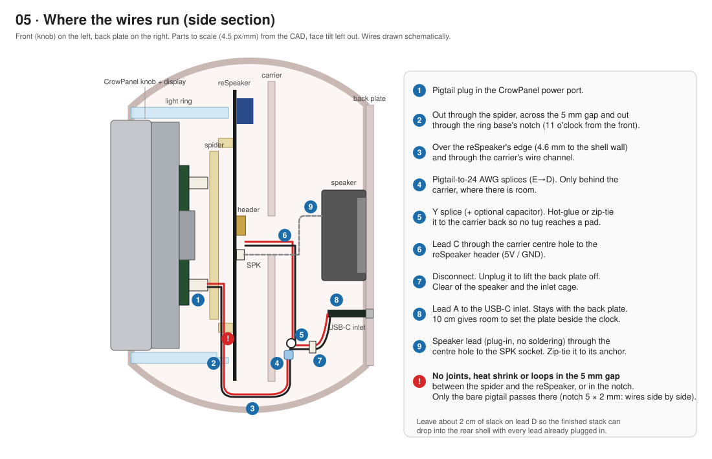

# Voice Clock wiring and soldering

The only wiring inside the clock is power: one 5 V USB-C inlet feeds both boards. The speaker plugs into the reSpeaker and the mute button is mechanical, so neither needs any soldering.

**Printable version:** [`wiring_sheets.pdf`](wiring_sheets.pdf) (5 landscape pages, one per sheet below). Print it and keep it on the bench.

**Time:** about 1.5 hours, including the bench checks.

---

## What to buy (on top of the main parts list)

| Qty | Part | Notes |
|---|---|---|
| 1 | MX1.25 4-pin pigtail, 10–15 cm (often sold as "Molex PicoBlade 1.25 mm 4P") | Goes into the CrowPanel's power port. Buy a pack; they're cheap. Keep the supplied USB cable intact for bench flashing. |
| 1 pair | 2-pin wire-to-wire connector, ≥ 3 A, 22 AWG leads: **JST-SM** (LED-strip type) or **JST-XH** male/female | The back-plate disconnect. JST-PH isn't suitable: its crimps only take 24–32 AWG and it's rated 2 A. |
| — | Silicone wire: 22 AWG red + black, 24 AWG red + black | About 30 cm of each is plenty |
| — | Heat shrink: 1.5, 2.5 and 4.8 mm | |
| 1 | 470 µF / 10 V electrolytic capacitor (optional) | Smooths amp peaks at the Y splice |
| — | Flux-core solder (0.6–0.8 mm), flux pen, hot glue, small zip ties | |

## Cut list

Cut everything long and trim it at the test fit (sheet 05).

| Lead | Wire | Length | From | To |
|---|---|---|---|---|
| **A** | 22 AWG red + black | 10 cm | USB-C breakout VBUS / GND | Disconnect, **socket** half |
| **B** | 22 AWG (the connector's own leads) | 3 cm | Disconnect, **pin** half | Y splice |
| **C** | 22 AWG red + black | 10 cm | Y splice | reSpeaker header: 5V (row 1 right), GND (row 2 left) |
| **D** | 24 AWG red + black | 8 cm | Y splice | Inline splice to the pigtail |
| **E** | MX1.25 pigtail (28 AWG, as bought) | 10 cm | Inline splice | CrowPanel power port |

---

## Sheet 01: the whole circuit

The current budget is about 3 A peak in total: the reSpeaker takes up to about 1.6 A (amp peaks plus a full-white LED ring) and the CrowPanel up to about 1 A. Use a 5 V 3 A charger.

## Sheet 02: reSpeaker, 5 V and GND

Solder to the **2×10 through-hole header** on the back of the board, not to the XIAO. Through-hole joints are much stronger than surface pads, and the header carries the board's 5 V rail.

1. **Check first:** power the reSpeaker from its own USB-C on the bench and measure the header's **5V** (row 1, right) to **GND** (row 2, left). You should read about 5.0 V. Unplug it, then beep the header 5V to the XIAO's 5V pin. It should beep. If either check fails, stop and look at Seeed's pinout before going on.
2. Slide 2.5 mm heat shrink onto each wire of lead C. Strip 2–3 mm and tin the ends.
3. Push the red wire into **row 1, right (5V)** from the back side. Solder it on the LED side and trim it to 1 mm or less. That side has only a 5 mm gap to the spider.
4. Push the black wire into **row 2, left (GND)** the same way. It's on a ground plane, so use about 370 °C and hold the iron there for 3–4 s until the solder flows round the hole.
5. **VDDIO is right next to the 5V hole and is not 5 V.** Check under a light that nothing bridges them.
6. Hot-glue both wires to the board's back about 10 mm from the joints, away from the mic holes.

## Sheet 03: CrowPanel via a plug-in pigtail

Elecrow's schematic only brings 5 V into the CrowPanel's main board through its 12-pin FPC (pins 1–2 = 5 V, 11–12 = GND) and a tiny test pad. Rather than soldering to the display, feed 5 V into the same 4-pin port that the supplied MX1.25-to-USB cable uses.

1. **Find the pins.** Plug the supplied cable into a USB charger. With a sewing needle taped to each meter probe, probe pairs of contacts in the MX1.25 plug until you read **+5.0 V**. The red probe is on 5 V and the black probe on GND. Note both positions.
2. On the spare pigtail, identify those **same positions**. Its wire colours mean nothing.
3. Cut the other two wires (D+ and D−) 5 mm back, and sleeve each one separately in 1.5 mm shrink.
4. Splice the 5 V and GND wires to lead D (24 AWG red and black) with inline splices staggered 10 mm, then put one 4.8 mm sleeve over the pair.
5. **Test:** plug the pigtail into the panel and feed it 5 V. The clock face should boot.

## Sheet 04: inlet, disconnect, Y splice

- **USB-C breakout:** solder lead A to **VBUS** and **GND**, going by the silkscreen. Leave CC1, CC2, D+ and D− alone. Check that CC1 to GND and CC2 to GND each read about 5.1 kΩ. Without those resistors a USB-C charger supplies nothing.
- **Disconnect:** the **socket** (shrouded) half goes on the inlet side, so a loose lead can't short. Pin 1 is red.
- **Y splice:** for each colour, lay B, C and D side by side with the ends pointing the same way. Twist, solder, trim to 8 mm and cover with 4.8 mm shrink. Stagger the red and black joints by 15 mm. If you're fitting the capacitor, solder its long leg into the red joint and its striped short leg into the black joint before you shrink them.

## Sheet 05: the route inside the case

Keep the 5 mm gap between the spider and the reSpeaker, and the ring base's notch, clear of joints. Only the bare pigtail passes through them. Every splice sits behind the carrier.

The ring base's notch and the carrier's notch are at **11 o'clock seen from the front** (between two LEDs, clear of the reSpeaker's USB-C and audio jack at 9 o'clock). From there the pigtail runs down the 4.6 mm gap between the board edge and the rear-shell wall. The whole electronics stack, with every lead plugged in, drops into the rear shell in one piece (hold the pigtail at 11 o'clock as it goes in: the rear shell's collar has a gap for it only there), and the front shell then twist-locks on with no wires attached to it, so it can come off without unplugging anything.

---

## Power-up checklist

Do these in order. Stop at the first one that fails.

1. With nothing plugged in, measure 5 V to GND at the disconnect's pin half. It must **not** read 0 Ω.
2. Plug the charger into the inlet and meter the socket half: **+5.0 V** with the red probe on pin 1.
3. Unplug the charger, join the disconnect, and plug the charger back in. The clock face boots and the reSpeaker's LED ring lights.
4. Play audio loud (with the volume capped in ESPHome). Header 5V to GND should stay above 4.75 V.
5. Tug each lead gently. Nothing should move at a joint; the hot glue or ties should take the load.

**Back-feed rule:** never plug a laptop into either board while the inlet is powered.

## v2 note: the UART link

The CrowPanel's UART pins are level-shifted to **5 V logic** (BSN20 MOSFETs pulled up to 5 V in Elecrow's schematic). The XIAO ESP32-S3 is 3.3 V only. For a future ESP-to-ESP link, add a level shifter. Don't run those wires for v1.

## Sources and what still needs checking

- reSpeaker header labels: Seeed's pinout image (`files.seeedstudio.com/wiki/respeaker_xvf3800_usb/pinout.jpg`), from the [XVF3800 + XIAO getting-started wiki](https://wiki.seeedstudio.com/respeaker_xvf3800_xiao_getting_started/). CNX Software's spec summary gives "5 V via USB or pin header".
- CrowPanel power nets and the UART level shifters: Elecrow's schematic `ESP32_Display_2.1(K)_Main_V1.0` in the [CrowPanel 2.1 GitHub repo](https://github.com/Elecrow-RD/CrowPanel-2.1inch-HMI-ESP32-Rotary-Display-480-480-IPS-Round-Touch-Knob-Screen).
- **Not confirmed by vendor docs, so check with a meter (the steps above include it):**
  - that the header's 5V feeds both the XVF3800 and the XIAO
  - which of the CrowPanel's rear ports is the power port, and its pin order
  - the pad names on your USB-C breakout
