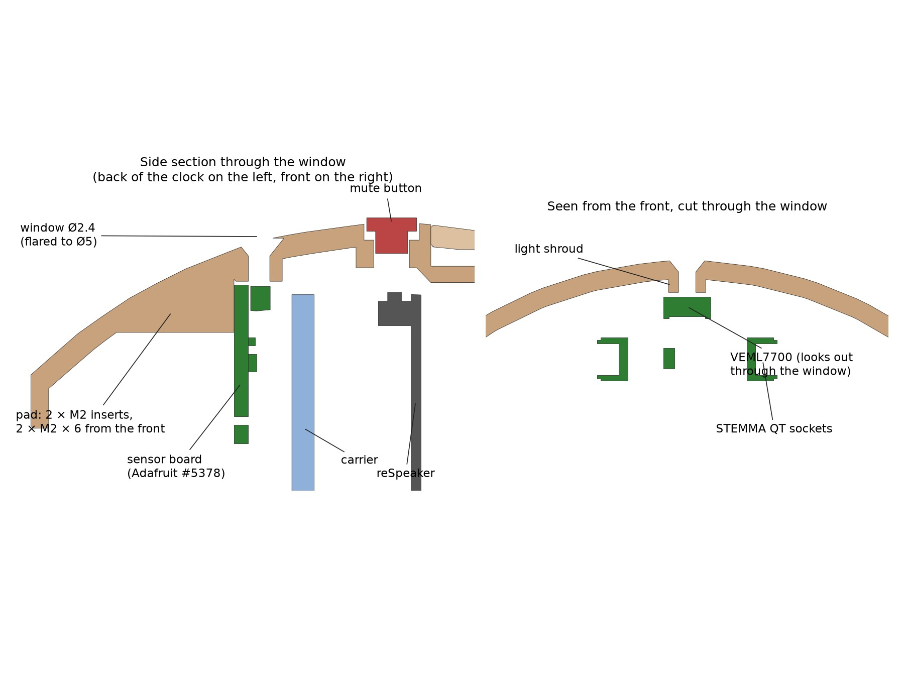

# v3 light-sensor variant (UNTESTED)

> **Status, 13 Nov 2026: designed and checked in CAD only.** Nothing here has been printed, wired or run on the hardware. The standard v2 files in `print/` are the ones that have been printed. Treat this as a first draft. If you print it, please open an issue with how it went.

This variant adds an ambient light sensor, so the clock can switch to night mode when the room goes dark instead of guessing from the sun and the lamps.



## What's different from v2

Only two parts change; print everything else from the standard files.

| File | Replaces | Change |
|---|---|---|
| `rear_shell_light_sensor.stl` / `.step` | `rear_shell` | Adds a flat pad with 2 M2 heat-set inserts at 12 o'clock, behind the carrier, for the sensor board. Also adds a Ø2.4 mm window (teardrop roof, flared to Ø5 outside) just behind the mute button, and a small shroud round it on the inner wall. All of it prints without supports, back rim down as before. |
| `carrier_light_sensor.stl` / `.step` | `carrier` | A 5 mm notch in the rim at about 1 o'clock for the sensor lead. |
| `VoiceClock_U1_light_sensor.3mf` | `VoiceClock_U1.3mf` | The full 4-plate Snapmaker U1 project with both changed parts. |
| `VoiceClock_wood_U1_light_sensor.3mf`, `VoiceClock_walnut_fs_008_U1_light_sensor.3mf` | the wood variants' U1 projects | The cherry and Full Spectrum walnut shells with the sensor window, sliced. |

The STL rear shell has the knit texture, like the standard one. Orca's "floating regions" warning on the rear shell comes from a small island at the reset-button pocket that v2 already has, not from the sensor parts.

## Why it's built this way

- **The sensor.** Adafruit #5378, a right-angle VEML7700 on a STEMMA QT board (about $5). It reads from about 0.004 lx to 120,000 lx, so it can tell "dark" from "very dark", which is what the night mode needs. Its sensor looks out of the board's edge, so the board lies flat and only a small window shows on the case. Adafruit publishes its STEP file, which is in `cad/vendor/` under Adafruit's MIT licence.
- **Where it looks.** Up and 15° back, from the top of the case, so the display and the glowing light ring stay out of its view. Otherwise the clock would partly measure its own light and dim itself.
- **Why not the screen's I2C port.** The CrowPanel's connectors sit inside the light ring, whose walls run from the reSpeaker right up to the face. A lead to them would have to go through the ring, leaving a dark spot (v2 removed its cable notch for that reason), or through the reSpeaker. Instead the sensor joins the I2C bus that the reSpeaker's XIAO already uses for the XVF3800 (address 0x10 vs 0x2C). The light level reaches the clock through Home Assistant, the same way the sun and lamp states already do.

## Extra parts

| Qty | Part |
|---|---|
| 1 | Adafruit #5378 right-angle VEML7700 lux sensor (STEMMA QT) |
| 1 | STEMMA QT / Qwiic cable (JST SH 4-pin), 100–150 mm |
| 2 | M2 × 6 socket head screws (M2 × 8 or longer would break through the shell) |
| 2 | M2 heat-set inserts (3 × 3.2 mm), the same as the rest |

## Build and wire it

1. **Assembly:** step 8 of the [assembly guide](../../docs/assembly/ASSEMBLY.md). Press the 2 inserts into the pad, then lower the board in through the front of the empty rear shell. Hold it a little toward the middle as it passes the bayonet collar (its corners are 0.7 mm wider than the collar). Then screw it down with a 1.5 mm hex key straight from the front.
2. **Wiring:** [sheet 06](../../docs/wiring/WIRING.md#sheet-06-light-sensor-v3). Solder the cut end of the cable to the XIAO's 3V3, GND, D4 (SDA) and D5 (SCL), and route it through the carrier's notch.
3. **Firmware:** add [`firmware/respeaker-light-sensor.yaml`](../../firmware/respeaker-light-sensor.yaml) to the reSpeaker's ESPHome config and reflash it. The clock's `voice-clock.yaml` already reads the sensor (`lux_sensor`). It enters night mode below **Night Light Level** (3 lx by default, set in HA) and leaves above twice that.

## What has been checked, and what hasn't

**Checked:**
- `VC_LIGHT_SENSOR=1 python check.py` passes.
- The board is 2 mm clear of the carrier and 8.6 mm behind the reSpeaker.
- The window is open from the sensor face to the outside, including through the knit texture.
- The sensor sits 0.5 mm from the shroud.
- The board fits in past the collar, and the insert holes stay inside the wall (1.5 mm of shell outside).
- A straight hex key reaches both screws.
- The reSpeaker package validates, and the clock firmware compiles.

**Not checked:**
- The print itself: the window and shroud surface, and how the pad prints in wood PLA.
- The board's real fit against the curved wall.
- The XIAO pin names (taken from Seeed's pinout image; meter them first).
- The cable's wire colours.
- The sensor's readings through the window, and a good night threshold for a real bedroom.

To rebuild these files from source:

```bash
cd cad
VC_LIGHT_SENSOR=1 .venv/bin/python voice_clock.py
VC_LIGHT_SENSOR=1 .venv/bin/python check.py
VC_LIGHT_SENSOR=1 .venv/bin/python make_3mf.py
```
