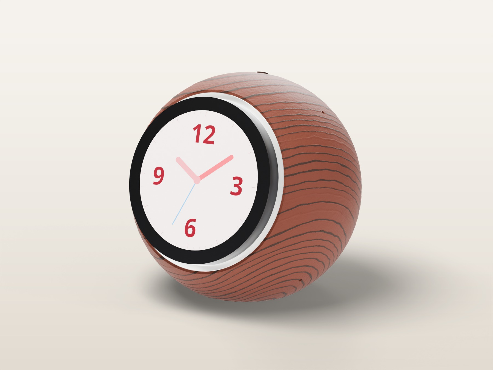
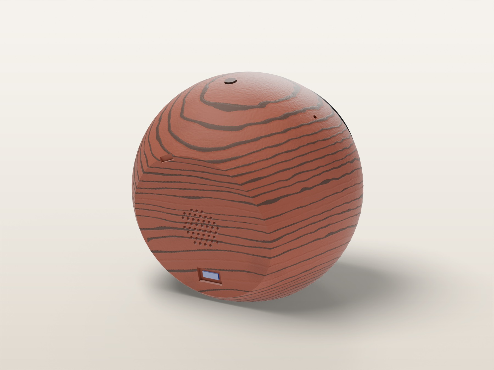
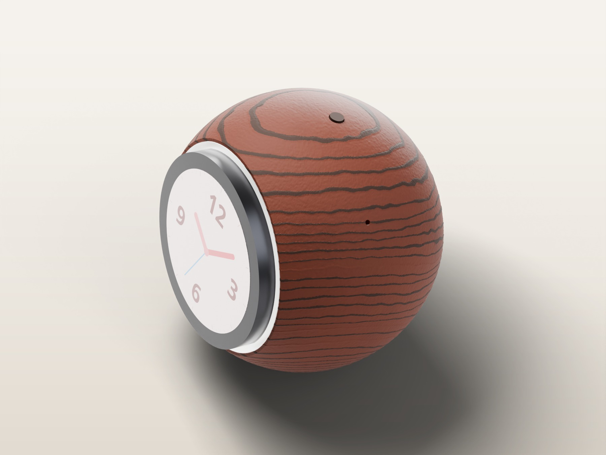
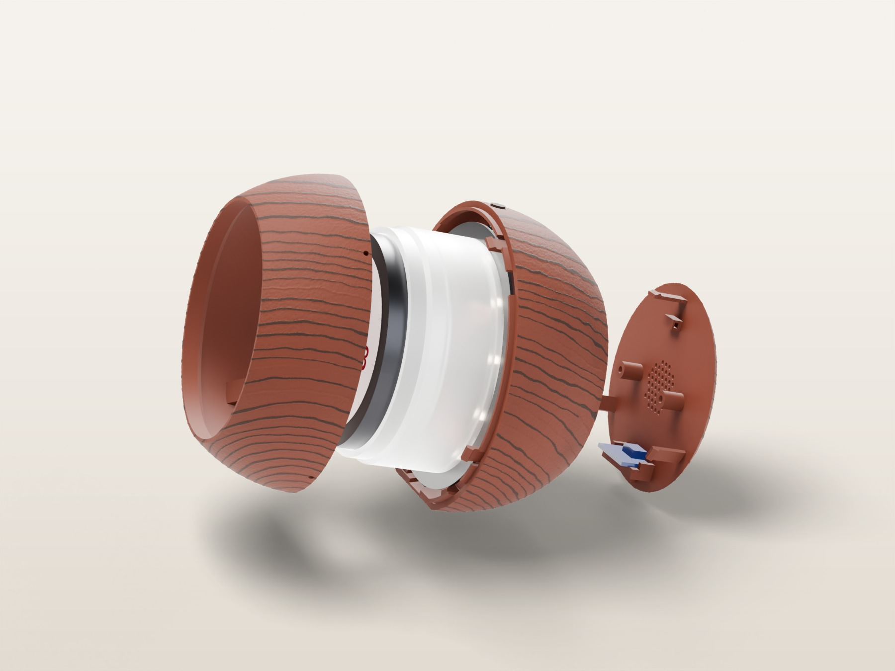

# Variant: turned cherry (wood PLA, Snapmaker U1)



An alternate exterior for the same v1 enclosure. The front shell, rear shell and back plate look as if they were turned from a single piece of cherry heartwood. Fine walnut growth rings vary in weight from year to year, and the faintest years show only as pore texture. One procedural log runs through the whole clock, so the grain is continuous across all three parts. Every outside surface (sphere, flat base, back, face rim) also carries a faint 0.15 mm open-pore relief. The mute button prints in walnut.

|  |  |
|---|---|
|  | Renders use the exact per-head colour assignment from the print file. The colours are matched to the spools by eye. |

Geometry, fit and assembly are identical to the standard version. Print the internals from [`../plates/VoiceClock_internals_PETG.3mf`](../plates/VoiceClock_internals_PETG.3mf) and follow [`docs/assembly`](../../docs/assembly/ASSEMBLY.md).

## Filament

Made for the JAYO Wood PLA 4-pack (walnut, "logs"/oak, cherry, maple; 250 g each, 15 % wood fibre). This design uses two of them:

| U1 head | Spool | Used for | Nozzle °C | Used |
|---|---|---|---|---|
| 1 (T0) | Cherry | the wood, and all the hidden structure inside | 210 (drifts 202–217) | 105 g |
| 2 (T1) | Walnut | growth rings, mute button | 212 (drifts 210–217) | 16 g |
| 3, 4 | Maple, oak | not used (presets included for your own variations) | — | — |

The print takes about 8 h 40 min on one plate (both shells, back plate, button), with 254 layers at 0.2 mm and 223 tool changes.

## Files

- [`VoiceClock_wood_U1.3mf`](VoiceClock_wood_U1.3mf): full Snapmaker Orca project with the printer, process, filaments and painted model. Open it with **File → Open Project**, slice and send. It points its post-processing script at `/home/asher/.local/share/voice-clock/wood_temps.py`. On another machine, run `cad/wood_project.py` once (below) to install the script and rebuild the project with your own path.
- [`VoiceClock_wood_model.3mf`](VoiceClock_wood_model.3mf): the painted model only, for your own presets. The paint is per-triangle extruder painting (Orca's `paint_color`), extruders 1 and 2.
- [`presets/`](presets): the `0.20mm Turned Wood` process and the four JAYO wood filament presets (based on Snapmaker's PLA Wood @U1 0.4 profile). Max flow is 12 mm³/s, the bed is at 60 °C, and the shells get a 5 mm brim.

## How it works

1. **Grain → paint** ([`cad/wood.py`](../../cad/wood.py)). A 3D growth-ring field (a log axis across the face, the pith just below the base, Perlin-warped rings, uneven ring widths and faint years) decides the colour of every outside triangle. Orca then extends each painted region 1.2 mm into the wall (`mmu_segmented_region_max_width`) and gives each colour its own toolhead. The U1 is a toolchanger, so there's no purge between colours. The same field carves the relief: open earlywood pores sit 0.12 mm low, and fibre streaks run along the grain.
2. **Tone drift** ([`cad/wood_temps.py`](../../cad/wood_temps.py), an Orca post-processing script). Wood PLA prints darker when it's hotter, so each head's printing temperature wanders slowly with height: ±9 °C at most, no more than 1 °C per layer, over a 14–29 mm wavelength. Each wood shades naturally instead of in stripes. Standby temperatures are left alone. The U1's ooze prevention drops idle heads to about 60 °C, so wood never sits hot in a nozzle and chars. It's pure Python (it runs inside the Orca flatpak) and skips files it has already processed.
3. **Project** ([`cad/wood_project.py`](../../cad/wood_project.py)). Writes the presets, installs the script and the user presets for Snapmaker Orca, builds the painted 3MF, and slices it with Snapmaker Orca's own CLI. The CLI doesn't run post-processing scripts, so it then runs `wood_temps.py` inside the same sandbox.

```bash
cd cad
.venv/bin/python voice_clock.py       # shells (needs to run once)
.venv/bin/python wood.py              # painted, textured wood meshes -> out/wood/
.venv/bin/python wood_project.py      # presets, project 3MF, sliced + post-processed G-code -> out/wood/
```

Snapmaker Orca 2.4.1 CLI quirks the script works around: it segfaults on `wipe_tower_filament`, it doesn't resolve `inherits` for loaded preset files (so the process is flattened), and it re-arranges the plate unless you pass `--arrange 0`.

## Tuning the look (`cad/wood.py`)

| Constant | Effect |
|---|---|
| `RING` | ring spacing (3.6 mm) |
| `LATE_MIN`, `LATE_MAX` | dark-line thickness as a share of a ring (keep `LATE_MIN × RING` ≥ 0.45 mm so each line is at least one extrusion wide) |
| `FAINT` | higher = more years with no dark line |
| `PITH`, `AXIS` | where the log was: moves the arches and ovals of the figure |
| `SAPWOOD`, `HEART_R` | `True` brings back a maple/oak sapwood cap (heads 3 and 4) |

## Tips

- Print the back plate on its own first to check the U1 handles wood PLA on two heads without clogging.
- Wood PLA is a little less flexible than plain PLA. The snap hooks only flex 0.5 mm (0.7 % strain), but snap the shells together gently the first time.
- A light sand (400 grit) and a wipe of oil or paste wax deepens the grain.
