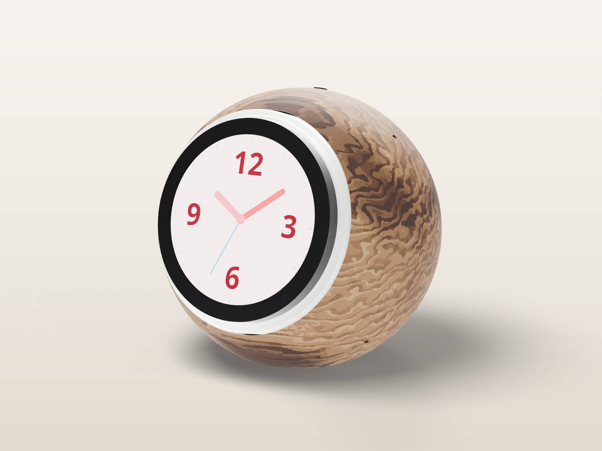
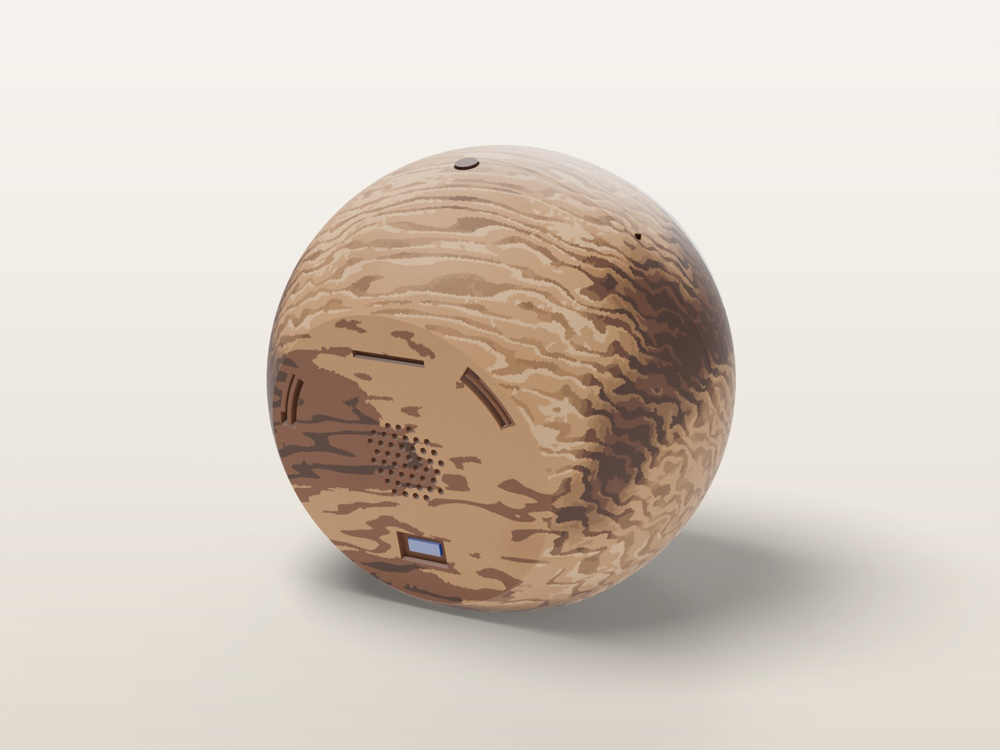
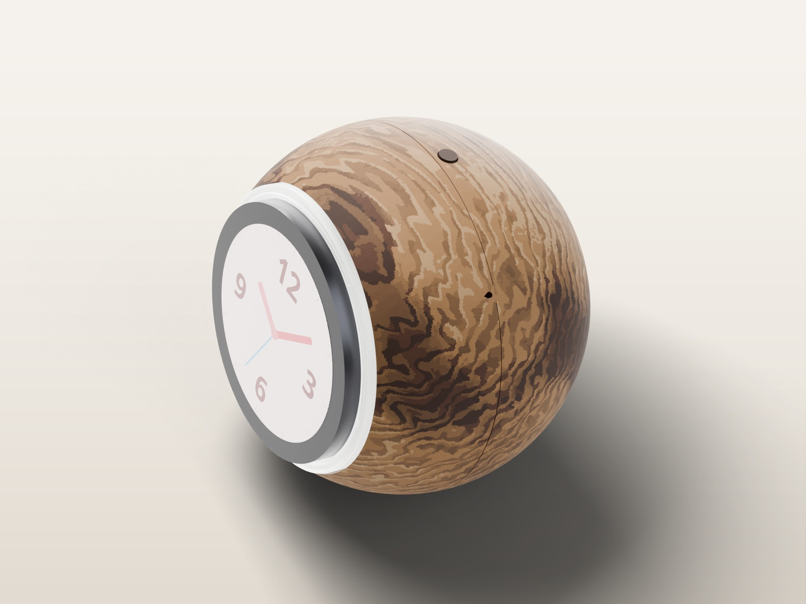
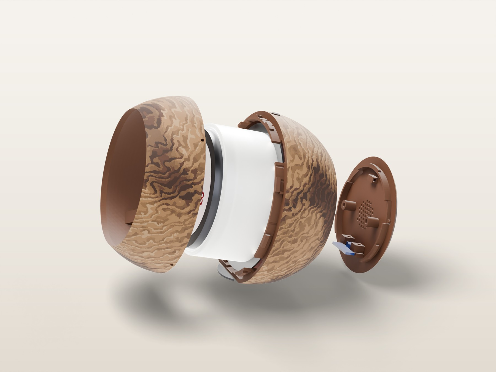

# Voice Clock: turned walnut, Full Spectrum (Snapmaker U1)

| | |
|---|---|
|  |  |
|  |  |

A wood look made from a photo of a real turned walnut bowl. Snapmaker Orca's **Full Spectrum** colour mixing turns the U1's 4 heads into **8 tones**, so the grain carries real shading:
- fine side-grain streaks whose depth fades along the grain
- rippled end grain
- lighter earlywood at the start of each ring
- soft, graded heartwood zones

There is **no cherry**: head 3 is maple, used only in the two lightest tones.

Like the other wood variants, only the outer skin is wood PLA. Everything under it (bayonet lugs, collar, ribs, bosses) is plain PLA, and each head holds one temperature for the whole print.

## How the mixing works

Full Spectrum fakes in-between colours by stacking very thin layers of different filaments: walnut, oak, walnut, oak, ... reads as a brown halfway between them. Each tone below is a physical head or an exact repeating layer sequence. The slicer paints the skin with these tones, and the printer swaps heads from layer to layer where a mixed tone is painted.

| Tone | Layer sequence | Expected L* | Where it goes |
|---|---|---|---|
| 1 | walnut | 17 | heartwood cores, the darkest latewood |
| 2 | walnut, brown core | 28 | heartwood |
| 3 | walnut, walnut, oak | 37 | latewood in darker wood |
| 4 | walnut, oak | 43 | latewood lines |
| 5 | walnut, oak, oak | 48 | faint lines, end grain |
| 6 | oak | 56 | the golden base |
| 7 | oak, oak, maple | 66 | light earlywood |
| 8 | oak, maple | 70 | the lightest flecks |

The expected L* values come from averaging the filament colours. The swatch (below) shows the real ones. Compared with the photo, the tone spread matches well (median L* 48 against 51, darkest 10 % at 17 against 18). The colour is a little less orange than the photo, which was taken in warm light.

## Load the heads like this

| U1 head | Spool | Temperature | Used for |
|---|---|---|---|
| 1 (T0) | **Plain PLA, brown** | 215 °C | The core under the skin, and the dark half of tone 2 |
| 2 (T1) | **JAYO oak** | 206 °C | The golden base and most mixes |
| 3 (T2) | **JAYO maple** (replaces cherry) | 204 °C | Only the two lightest tones |
| 4 (T3) | **JAYO walnut** | 212 °C | The dark tones and the mute button |

No extra spool is needed.

## Layer height: 0.08 mm

| | |
|---|---|
| Project | `VoiceClock_walnut_fs_008_U1.3mf` |
| Print time | **about 1 day 9 h 44 min** |
| Layers / tool changes | 629 / 1,674 |
| Filament (core / oak / maple / walnut) | 120 / 54 / 23 / 54 g (251 g) |
| How the mixes look | 2-layer tones blend (0.16 mm repeat); 3-layer tones show fine 0.24 mm stripes up close, which blend at arm's length |

0.08 mm is the minimum layer height in the U1's 0.4 mm nozzle profile, so there is no finer option: going thinner would need a smaller nozzle, and wood PLA's particles clog nozzles under 0.4 mm.

Every layer uses all 4 heads (3 tool changes per layer), so time and prime-tower waste scale with the number of layers. Most of the wood filament goes into the prime tower, not the skin. The G-code is in the local print folder only; in the repo, open the 3MF in Snapmaker Orca 2.4.1 or later and slice it.

## Print the swatch first

`coupons/FS_swatch_008.3mf`: a 72 × 3 × 4 mm plate whose front face shows the 8 tones as 9 mm stripes, darkest on the left, with the same heads, temperatures and mixes as the clock. About 1 h 11 min (12 g, mostly prime tower: every layer still swaps through all 4 heads).

Check:
1. **Colours:** the 8 stripes should step evenly from walnut to light gold. If two neighbours look the same, or one stands out, the mix needs refitting (`FS` in `CAD/wood.py`).
2. **Stripes:** look at the 3-layer tones (3, 5 and 7) from 30 cm away and from arm's length.

## How it's built

- **The log:**
  - The rings are 4.4 mm apart (the photo's 3 mm scaled up 1.5×, so every line is at least 2 paint samples wide).
  - They come from far out in a big log, so they run nearly parallel, rippled across the grain.
  - The log runs across the face, like a bowl turned from a board.
- **Each ring:** a lighter start (earlywood, +5 L*) and a latewood line (−17 L*). The line's depth fades along the grain, so streaks fade out in tone instead of stopping. A line is at least 0.9 mm wide or absent.
- **End grain** is 6 L* darker overall, as in the photo.
- **Heartwood:** broad zones darken smoothly by up to 36 L*, so their edges step through several tones instead of a hard boundary.
- **Dither:** a little noise before rounding to the 8 tones keeps gradients from banding.
- **Bed face:** the back plate's outer face prints on the bed, where a single layer can't show a mix, so it uses only physical heads (oak, brown, walnut). Its latewood lines are carved one first layer (0.22 mm) deep, so the face isn't one glossy bed surface: the golden land touches the bed and stays glossy, while the grain lines are bridged by the second layer and print matte, in walnut. Keep the first layer at 0.2 mm.

## Files

- **`VoiceClock_walnut_fs_008_U1.3mf`:** the full Snapmaker Orca project (printer, process with the 6 mixed rows, 4 filaments, painted model).
- **`VoiceClock_walnut_fs_008_U1.gcode`:** sliced, in the local print folder only.
- **`VoiceClock_walnut_fs_model.3mf`:** the painted model only (the generator names it `VoiceClock_walnut_fs_008_model.3mf`). It needs a process preset with the mixed rows (in `presets/`) to show the mixes.
- **`presets/`:** the 4 filament presets, the process and the printer.
- **`coupons/`:** the tone swatch.
- **`renders/`** (local print folder) and [`docs/img/wood/`](../../docs/img/wood) (repo): Blender renders, each tone shown as its blended colour.

## Tuning

Everything is in `CAD/wood.py`:
- `FS_TONES` / `FS_ROWS`: the tones and their layer sequences.
- `FS`: lightness model, with `BASE_L`, `LINE_D`, `HEART_D`, `END_D` and `DITHER`.
- `WN`: grain geometry.

Then run `wood.py walnut_fs`, then `wood_project.py walnut_fs`, and `fs_swatch.py walnut_fs`.

## Finishing

1. Mask the bayonet lugs and blocks, the ring bore, the back-plate lip and the mic holes.
2. Scuff the outside lightly with a 320 foam pad along the grain.
3. Wipe on 2–3 thin coats of satin wipe-on polyurethane, with 0000 wool between coats. The finish also evens out the slight sheen difference between the plain-PLA core and the wood PLA in tone 2.
4. Let it cure for 7 days.

No stain.
